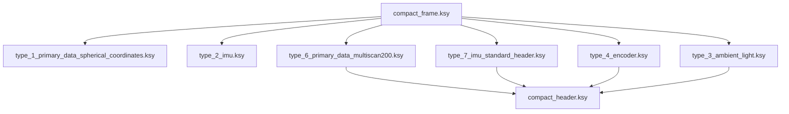

# Compact Format

The Compact format is SICK's binary format for measurement data. It uses the least bandwidth of all formats and can be parsed very efficiently, for example by copying the bytes into a C struct with `memcpy`. The fields are not self-describing: your parser must know the layout, which SICK publishes as [Kaitai Struct](https://kaitai.io/) definitions.

The multiScan100 and picoScan100 send each scan segment in a UDP datagram.
The LRS4000 and multiScan200 carry it as a framed telegram in the TCP stream.
Every segment can be processed on its own, which keeps latency low. To work
with a full scan (frame), collect all segments with the same `frame_number`.

To inspect a captured telegram field by field, paste it into the free, browser-based [Kaitai Web IDE](https://ide.kaitai.io/) together with the definitions below.

The Compact format is organized as one frame definition that dispatches to the
individual telegram types. Types 3, 4, 6, and 7 also share the standard header:



The authoritative Kaitai Struct definitions are in the [`formats` folder on GitHub](https://github.com/SICKAG/KaitaiStructDescriptions/tree/public/formats). Use those files for the complete field layout instead of copying a format definition into this page.

To receive Compact data without writing your own parser, use the C++ [sick_perception_sdk](../recording/sick-perception-sdk.md). It receives the scan, IMU, and encoder data and provides the scans as point clouds.

## Frame Layout

All multi-byte values are little-endian. The frame contains a start marker, a
telegram type, the type-specific payload, and a CRC32 checksum. Verify the
checksum before processing the payload. Use the authoritative
[`compact_frame.ksy` definition on GitHub](https://github.com/SICKAG/KaitaiStructDescriptions/blob/public/formats/compact_frame.ksy)
for the complete frame layout.

## Standard Header

Telegram types 3, 4, 6, and 7 start their payload with the same header. Types
1 and 2 do not. For the complete field layout, use the authoritative
[`compact_header.ksy` definition on GitHub](https://github.com/SICKAG/KaitaiStructDescriptions/blob/public/formats/compact_header.ksy).

For type 4 with `telegram_version` 1, `payload_length` includes `sender_id`; from version 2 onwards it does not.

## Type 1: Scan Data

The scan payload is a header followed by one or more modules. Each module carries per-layer metadata plus the beam data for its layers. Read the first module size from the telegram header, then use each module's `next_module_size` to find the next one; zero marks the last module. Do not assume all modules have the same size.

Read `telegram_version`, `data_content_echos`, and `data_content_beams` before parsing beam data. Versions 3 and 4 have different beam-field ordering; version 4 also adds a distance scaling factor to the module metadata. For version 4, convert a raw distance to millimeters as `distance_mm = distance_raw × distance_scaling_factor`. All segments of one scan share `frame_number` and differ by segment index. The authoritative definition is [`type_1_primary_data_spherical_coordinates.ksy` on GitHub](https://github.com/SICKAG/KaitaiStructDescriptions/blob/public/formats/type_1_primary_data_spherical_coordinates.ksy).

To convert a beam to a 3D point, use `phi` (elevation), `theta` (azimuth), and the distance `d`:

```txt
x = d · cos(phi) · cos(theta)
y = d · cos(phi) · sin(theta)
z = d · sin(phi)
```

### Measurement Data Conventions

#### Azimuth Angles

The `theta` values within a segment are monotonically
increasing. For a 360° sensor, a segment that crosses the +180°/−180° boundary
can therefore continue beyond 180° instead of wrapping immediately to a
negative value. In the example below, the blue segment runs from 160° to 189°,
while the following green segment uses −170° to −141°. Preserve this ordering
while parsing; normalize the angles only afterwards if your application needs
the range (−180°, 180°].

{ width="360" }
*Azimuth values remain monotonically increasing within a segment.*

#### Segment Counters

Normally, the segment counter is between `0` and
`number_of_segments - 1` and increases with the azimuth. The multiScan100 has
one exception: when most beams in a segment lie beyond 180°, that segment
belongs to the next frame and receives counter `0`. With 30° segments, an
angle-only calculation would produce counter `12`, which wraps to `0`. Use the
transmitted counter rather than deriving it from `theta`.

{ width="480" }
*The blue segment belongs mainly to the next frame and therefore receives counter 0.*

#### RSSI Values

Compact and MSGPACK represent RSSI as a dimensionless 16-bit
unsigned integer. Treat the full range from `0` to `65535` as valid, although a
device may never reach the maximum. RSSI is not standardized, so absolute
values are not directly comparable between device families.

Some device outputs scale an internally measured 8-bit RSSI value depending on
the output format:

<p class="table-caption" markdown>**RSSI Values:** format, bit depth, and conversion.</p>

| Format | Bit depth | Conversion |
| --- | --- | --- |
| Compact type 1 | 16-bit | `16bit = (8bit / 255) × 65535` |
| MSGPACK | 16-bit | `16bit = (8bit / 255) × 65535` |
| `LMDscandata` (CoLa) | 8-bit | none; value `254` = reflector detected |

In 16-bit output, the low byte equals the high byte (for example `0xe6e6`). This is expected.

**Bit fields and beam properties.** `data_content_echos`,
`data_content_beams`, and each beam's `properties` value are bit fields. Test
bit `i` with `(value & (1 << i)) != 0`; do not interpret the complete decimal
value as a single state. In `properties`, bit 0 means that a reflector was
detected for at least one echo of the beam. This can be treated as applying to
the last echo because a reflector echo is not physically followed by another
echo on the same beam. Bits 1 through 7 are reserved and must be ignored.

### Segments (picoScan100)

The picoScan100 scans a range of 276°. One 276° rotation of the scan layer is one scan (frame). For output, each scan is split into segments of a fixed angular size:

<p class="table-caption" markdown>**Segments (picoScan100):** scanning frequency, segment size, and segments at 276°.</p>

| Scanning frequency | Segment size | Segments at 276° |
| --- | --- | --- |
| ≤ 25 Hz | 30° | 10 |
| ≥ 30 Hz | 60° | 5 |


*Example of 30° scan segments within the 276° scan range.*

Segment boundaries do not move when you reduce the scan range. Measured values in hidden angle ranges are filled with zeros, and a segment that is completely hidden is not sent. Example: 180° (−90° to +90°) at 40 Hz gives 4 segments.

### Segments (multiScan100)

The multiScan100 captures a 360° frame across its scan layers and divides the
output into time-based segments. Each segment contains data from all scan
layers, but the azimuth ranges of those layers do not necessarily line up
spatially. Raw output keeps the original layer timing. Rectified output aligns
the layer start angles as closely as possible and adds at least one segment
interval of latency. See the [multiScan100 overview](../multiScan100/index.md)
for device-specific output context.


*A 360° frame split into twelve 30° segments, each with its own time stamp.*

Each segment covers a different time within the rotation, so `t0` to `t11`
increase in the scan direction. Use the per-segment time stamps rather than the
frame time when you fuse the data with motion or another sensor.

## Type 2: IMU

A flat, fixed-size payload from the integrated inertial measurement unit. It
has no standard Compact header and no optional fields. IMU output is available
on multiScan100 and picoScan100; sampling and available fields depend on the
product. The LRS4000 provides IMU data through CoLa events or
`GET /api/InertialMeasurementUnit`, not as a Compact telegram. The authoritative Compact layout is
[`type_2_imu.ksy` on GitHub](https://github.com/SICKAG/KaitaiStructDescriptions/blob/public/formats/type_2_imu.ksy).

The data is specified in the following coordinate system based on the DIN 70000
system: The x-axis lies on the 90° beam of the 0° plane. The y-axis is
perpendicular to the x-axis and lies in the 0° plane. The y-values increase in
the counter rotation direction (right-handed system). The z-axis is
perpendicular to the y-axis and the top of the device points towards increasing
z-values.

{ width="520" }
*IMU coordinate system based on DIN 70000.*

## Type 3: Ambient Light

The ambient-light image of the multiScan200 is sent as a separate telegram.
The sensor captures it passively through the same receiver as the distance
data. It follows the [standard header](#standard-header). Use the
authoritative definition linked below for its payload layout.

Distance and ambient-light data measured at the same time share the same
`frame_number`. Use the authoritative
[`type_3_ambient_light.ksy` definition on GitHub](https://github.com/SICKAG/KaitaiStructDescriptions/blob/public/formats/type_3_ambient_light.ksy)
for the complete payload layout.

## Type 4: Encoder

Reports an external rotary encoder attached to a moving axis (picoScan150).
One encoder telegram is sent per scan frame and linked to it by `frame_number`.
It follows the [standard header](#standard-header). Use the authoritative
definition linked below for its payload layout.

See [3D With 2D LiDARs](../integration-notes/3d-with-2d-lidars.md) for how to fuse encoder and scan data.

Use the authoritative [`type_4_encoder.ksy` definition on GitHub](https://github.com/SICKAG/KaitaiStructDescriptions/blob/public/formats/type_4_encoder.ksy) for the complete payload layout.

## Type 6: Scan Data (multiScan200)

The scan data of the multiScan200. One telegram carries one segment: a block
of columns (slots), each with all layers. It follows the [standard
header](#standard-header). Use the authoritative definition linked below for
the complete segment header and data-block layout.

Convert each pixel to a 3D point with the [formula for type 1](#type-1-scan-data), using the elevation angle of its layer as `phi` and the azimuth angle of its column as `theta`. Use the authoritative [`type_6_primary_data_multiscan200.ksy` definition on GitHub](https://github.com/SICKAG/KaitaiStructDescriptions/blob/public/formats/type_6_primary_data_multiscan200.ksy) for the complete segment header and data-block layout.

For interlaced scan configurations, `number_of_interlace_steps` is greater than 1 and consecutive frames must be combined to cover the full field of view; `current_interlace_index` identifies each frame's position in that sequence. Configured data reduction can also leave zero-filled distance and RSSI values in the fixed-size Compact segment, including for angles outside the selected range. A zero value alone therefore does not mean that the beam or column is absent.

## Type 7: IMU with Standard Header

The IMU data of the multiScan200. The content matches [type 2](#type-2-imu), but the payload starts with the [standard header](#standard-header) and has no `telegram_version` field of its own:

Use the authoritative [`type_7_imu_standard_header.ksy` definition on GitHub](https://github.com/SICKAG/KaitaiStructDescriptions/blob/public/formats/type_7_imu_standard_header.ksy) for the complete payload layout.

## Transport

<p class="table-caption" markdown>**Transport:** transport, formats and devices, connection, delivery guarantee, and best for.</p>

| Transport | Formats and devices | Connection | Delivery guarantee | Best for |
| --- | --- | --- | --- | --- |
| UDP unicast | Compact, MSGPACK (multiScan100); Compact, MSGPACK (picoScan100) | Sensor sends to one host | None; packets can be lost or reordered | Low-latency data to one host |
| UDP multicast | Compact (multiScan100); Compact, MSGPACK (picoScan100) | Sensor sends one stream to a group | None; packets can be lost or reordered | The same data to several hosts |
| TCP | Compact (LRS4000 and multiScan200); [LMDscandata](./lmdscandata-format.md) where supported | Client connects to a device-specific data port or CoLa port | Ordered and error-checked | Data integrity over latency; PLCs |

For UDP, select the required format in the data-output settings and set the
destination IP address and port. For multiScan100 and picoScan100, the REST
API exposes Ethernet destination settings for the scan data stream. The
picoScan100 factory default is `192.168.0.100:2115`.

The multiScan200 sends Compact data over TCP to avoid data loss, on separate
ports per content:

<p class="table-caption" markdown>**Transport:** TCP port, content, and telegram type.</p>

| TCP port | Content | Telegram type |
| --- | --- | --- |
| `2115` | Distance and RSSI, optionally with ambient light | [6](#type-6-scan-data-multiscan200) |
| `2116` | Ambient light only | [3](#type-3-ambient-light) |
| `2117` | IMU | [7](#type-7-imu-with-standard-header) |

Select **TCP Compact** as data output mode (`sWN dataOutputMode 1`); see the [multiScan200 CoLa Telegram Listing](../multiScan200/cola-telegram-listing.md#set-data-output-mode-swn-dataoutputmode).

The LRS4000 `ScanDataFormat` REST parameter supports Compact output. The
Compact stream uses TCP, with port `2115` as the Compact data port.

For multicast, set the destination to a multicast address in the range `224.0.0.0` to `239.255.255.255`. Every receiving host joins the same group and listens on the configured UDP port. The sensor sends each packet only once, however many hosts receive it. Make sure that switches and routers forward multicast traffic, and use IGMP snooping when several receivers are connected.

## Wireshark Dissector

SICK provides a Wireshark dissector for Compact measurement and IMU data, so you can inspect the stream field by field instead of reading raw bytes. It supports the Compact format only. Use it to confirm framing, ports, CRCs, and decoded values before you debug your own parser.

### Install the Dissector

1. Download and install [Wireshark](https://www.wireshark.org/download.html).
2. Download the dissector: [COMPACT_Dissector.lua](../assets/data-streaming/COMPACT_Dissector.lua).
3. In Wireshark, open **Help > About Wireshark > Folders** and copy the file to the **Personal Lua Plugins** folder.
4. Restart Wireshark.

### Decode Compact Data

Configure the sensor to output Compact format, then capture on the Ethernet
interface connected to the sensor. Enter `compact` as the display filter. The
Protocol column shows `COMPACT`; select a packet to inspect the decoded
structure and values such as distance.

On Windows, set the Ethernet network profile to Private so that the firewall does not block the stream:

```powershell
Get-NetConnectionProfile
Set-NetConnectionProfile -InterfaceIndex 18 -NetworkCategory Private
```

Replace `18` with the interface index reported by `Get-NetConnectionProfile`.

To disable the plug-in temporarily, choose **Analyze > Enabled Protocols** and clear its checkbox. See [Frame Layout](#frame-layout) for the telegram structure and [Wireshark | pcap](../recording/wireshark-pcap.md) for recording traffic.

### Related Articles

- [How to use the Wireshark dissector for Compact measurement and IMU data](https://support.sick.com/sick-knowledgebase/article?id=26b09bc9-22db-f011-8544-7c1e5228c8a2)
<!-- SICK video: 0_jnvpbvv5; source: https://support.sick.com/sick-knowledgebase/article?id=aeac8012-be4e-f011-877b-000d3a2a3508 -->
*How to receive IMU data and dissect it with Wireshark.*
- [How to use Wireshark to dissect Compact data](https://support.sick.com/sick-knowledgebase/article?id=9338f032-bd4e-f011-877b-7c1e5228c8a2)
