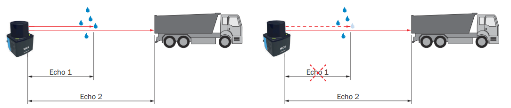

# Filter Details

Filters run on the sensor and change the measurement data before it is sent. Use them to reduce bandwidth, remove unwanted points, and keep the data your application needs. The available filters and their settings differ between devices; each section lists the devices it applies to.

**Filter Details:** filter, effect, side effect, and devices.

| Filter | Effect | Side effect | Devices |
| --- | --- | --- | --- |
| [Interval](#interval-filter) | Sends only every n-th scan | Lower output rate | multiScan100, multiScan200, picoScan150 |
| [Fog](#fog-filter) | Removes fog echoes at close range | - | multiScan100, picoScan150 |
| [Echo](#echo-filter) | Selects which echoes are sent | - | LRS4000, multiScan100, multiScan200, picoScan150 |
| [Particle](#particle-filter) | Removes dust, rain, and snow hits | Device-specific settings and latency | LRS4000, multiScan100, multiScan200, picoScan100 |
| [Moving average](#moving-average-filter) | Averages distances over several scans | Delayed output | multiScan100, multiScan200, picoScan150 |
| [Blooming](#blooming-filter) | Removes blooming artifacts next to highly reflective objects | - | multiScan200 |
| [Angle range](#angle-range-filter) | Keeps beams inside a horizontal and vertical angle range | - | multiScan100, multiScan200, picoScan150 |
| [Layer](#layer-filter) | Removes complete scan layers from the output | Reduced vertical coverage | multiScan100 |
| [Vertical FoV](#vertical-fov-filter) | Keeps nested vertical regions at different resolutions | Raw stream only | multiScan200 |
| [Angle range focus](#angle-range-focus-filter) | Keeps a 3D angle range with an optional full-resolution region | Raw stream only | multiScan200 |
| [Rectangular](#rectangular-filter) | Keeps points inside an X/Y rectangle | Other points set to 0; data size unchanged | multiScan100, picoScan150 |
| [Distance](#distance-filter) | Keeps points inside a radial range | Other points set to 0; data size unchanged | LRS4000, multiScan100, picoScan150 |
| [Ground](#ground-filter) | Filters ground returns with configurable thresholds | Variant and configuration dependent | multiScan100 |
| [Mean](#mean-filter) | Averages measurement data | Device-specific behavior | LRS4000 |
| [Median](#median-filter) | Applies a median filter to measurement data | Device-specific behavior | LRS4000 |

The filters run one after another, each on the result of the previous one. For exact parameter names and value ranges, see the product's OpenAPI reference: [LRS4000](../LRS4000/rest-api-openapi.md), [multiScan100](../multiScan100/rest-api-openapi.md), [multiScan200](../multiScan200/rest-api-openapi.md), or [picoScan100](../picoScan100/rest-api-openapi.md).

## Interval Filter

The interval filter reduces the scan output rate by a configurable reduction
factor from 2 to 50. For example, a factor of three outputs only every third
scan, reducing the output rate to one third. On picoScan100, this REST setting
is exposed by the picoScan150 OpenAPI.

## Fog Filter

The fog filter removes unwanted echoes at close range (approximately 3 m). This
reduces false activations in fog. On picoScan100, this REST setting is exposed
by the picoScan150 OpenAPI. The multiScan200 has no configurable fog filter.

## Echo Filter

The echo filter suppresses measurement data caused by edge hits, rain, dust,
snow, and other ambient conditions. Pulses attributed to undesirable ambient
conditions are not output. The selectable echoes differ by device:

**Echo Filter:** device and selectable echoes.

| Device | Selectable echoes |
| --- | --- |
| picoScan150 | First echo, last echo, or all echoes |
| multiScan200 | First echo, last echo, strongest echo, all echoes, or all echoes with the strongest first |
| LRS4000, multiScan100 | Read the selectable echo options for the installed firmware in the device's OpenAPI description. |

On the multiScan200, field evaluation always uses a single echo. If all echoes
are selected, field evaluation uses the first echo.

*Example of retaining or suppressing an echo caused by ambient conditions.*

## Particle Filter

The particle filter suppresses small, irrelevant reflection pulses caused by
dust, raindrops, snowflakes, and similar particles. The filter settings differ
by device.

**Particle Filter:** device and settings.

| Device | Settings |
| --- | --- |
| LRS4000 | On/off and a distance-step threshold from 500 to 5000 mm |
| multiScan100 | On/off and a distance-step threshold from 20 to 5000 mm |
| multiScan200 | On/off, a distance threshold from 20 to 2000 mm, and the minimum number of neighbors from 0 to 8 |
| picoScan100 | On/off and a distance-step threshold from 20 to 5000 mm |

For LRS4000, multiScan100, and picoScan100, the threshold is the required
distance step between the echo to be filtered and the echoes of surrounding
beam angles. On multiScan200, a point needs at least the configured number of
neighboring measurements within the distance threshold. In interlaced
multiScan200 scan configurations (10 to 12), the filter compares measurements
from different angular positions, so its effect can change. In the Compact
format (telegram type 6), bit 6 of the multiScan200 echo properties marks
points detected as particles.

## Moving Average Filter

On picoScan150, the moving average filter smooths distance values by calculating the arithmetic
mean over several scans of the same point. Configure an averaging depth of two
to four scans. The first value is output only after the configured number of
scans; invalid distance values (`0`) are excluded from the average.

Example of a four-scan moving average for representative angular positions
(distance values in mm):

**Moving Average Filter:** scan/output, angle 3, angle 4, angle 5, angle 6, angle 7, and angle 8.

| Scan/output | Angle 3 | Angle 4 | Angle 5 | Angle 6 | Angle 7 | Angle 8 |
| --- | ---: | ---: | ---: | ---: | ---: | ---: |
| Scan 1 | 1100 | 1100 | 1150 | 1150 | 1380 | 1380 |
| Scan 2 | 1200 | 1200 | 1190 | 950 | 1500 | 1500 |
| Scan 3 | 1150 | 1450 | 1200 | 1200 | 1450 | 1450 |
| Scan 4 | 1170 | 1170 | 1220 | 1220 | 1470 | 1150 |
| 1. Output (scans 1–4) | 1155 | 1230 | 1190 | 1130 | 1450 | 1370 |
| Scan 5 | 0 | 1110 | 1150 | 1150 | 1380 | 1380 |
| 2. Output (scans 2–5) | 1173 | 1233 | 1190 | 1130 | 1450 | 1370 |
| Scan 6 | 1200 | 1210 | 1190 | 0 | 1500 | 1500 |
| 3. Output (scans 3–6) | 1173 | 1235 | 1190 | 1190 | 1450 | 1370 |
| Scan 7 | 1150 | 0 | 1200 | 1200 | 1450 | 1450 |
| 4. Output (scans 4–7) | 1173 | 1163 | 1190 | 1190 | 1450 | 1370 |

Individual outliers still influence the average. Invalid distance values (`0`)
are excluded, so fewer scans contribute at those positions (for example angle 3
in the 2nd output: (1200 + 1150 + 1170) / 3 = 1173).

On multiScan200, the moving average filter is called high precision mode and
can only be switched on or off. It averages the distance of each point over
several scans, which reduces distance noise while the output rate stays the
same. The output is delayed by about 0.5 s. If the distance of an object
changes significantly, averaging stops for that object. Use it for static
scenes only. It has no effect in interlaced scan configurations (10 to 12).

On multiScan100, the REST API exposes `LFPmovingAveragingFilter`. Check the
OpenAPI description for the available averaging depth and limits for the
installed firmware.

## Blooming Filter

Highly reflective objects such as retroreflectors can create false points next
to the object (blooming). The blooming filter removes them. Select the strength
low, medium (default), or strong. In the Compact format (telegram type 6),
bit 2 of the echo properties marks points detected as blooming.

## Angle Range Filter

The angle range filter limits the output to a horizontal (theta) and vertical
(phi) angle range. A beam increment outputs only every n-th beam.

**Angle Range Filter:** comparison criterion, multiScan100, multiScan200, and picoScan150.

| | multiScan100 | multiScan200 | picoScan150 |
| --- | --- | --- | --- |
| Horizontal range | See OpenAPI | −180° to +180° | −138° to +138° |
| Vertical range | See OpenAPI | −90° to +90° | −90° to +90° |
| Beam increment | See OpenAPI | 1 to 50, separately for horizontal and vertical | 1 or more |

On multiScan200, beams outside the range are not transmitted, which reduces the
data size. The ambient-light image is limited in the same way.

## Layer Filter

The multiScan100 layer filter removes complete scan layers from the output
data. Configure one Boolean value per layer through `LFPlayerFilter`; only
enabled layers are serialized. This reduces the data volume when an application
needs only part of the sensor's vertical coverage. The filter changes the
output, not the physical scan performed by the sensor.

## Vertical FoV Filter

The multiScan200 CoLa command `verticalAngleRangeFilter` restricts raw
streaming data to an outer vertical region of interest (ROI). An optional inner
ROI must lie completely inside the outer ROI. Each region has its own layer
increment from 1 to 50, so the inner region can retain more vertical detail
while the surrounding region is subsampled more strongly. Layers outside the
outer ROI are not transmitted.

The filter also limits ambient-light data. In **Full** mode, the remaining
ambient-light region keeps its full vertical resolution. In **Matching** mode,
its vertical resolution matches the primary measurement data, with one
ambient-light pixel per beam.

## Angle Range Focus Filter

The multiScan200 `angleRangeFocusFilter` restricts raw streaming data to a 3D
field of view defined by horizontal (`theta`) and vertical (`phi`) limits.
Beams outside this range are not transmitted. Separate horizontal and vertical
increments from 1 to 50 can subsample the remaining data.

An optional focus region preserves full resolution inside a smaller horizontal
or vertical region while the surrounding data remains subsampled. This filter
affects raw data streaming only and does not affect field evaluation.

## Rectangular Filter

After the measurement filters, data-reduction settings and the region of
interest filter limit the points passed on for further processing. On
picoScan100, this REST setting is exposed by the picoScan150 OpenAPI.

When the rectangular filter is active, only scan parts within the rectangle are retained. The filter does not reduce the data; points outside the rectangle are set to zero. Adjust the rectangle by setting the minimum and maximum X and Y values in millimeters.

## Distance Filter

The distance filter limits the measured radial distance and therefore affects a
circular area around the product. It does not reduce the data; points outside
the selected radial range are set to zero. To keep a circular area, set the
maximum range to the required radius in millimeters. To keep a ring, set the
maximum range to the required radius and the minimum range to a value greater
than 0 mm. On picoScan100, this REST setting is exposed by the picoScan150
OpenAPI.

## Ground Filter

The multiScan100 REST API exposes `groundFilterEnable`,
`groundFilterThresholds`, and `groundFilterType`. The filter can reduce false
field-evaluation triggers caused by the ground while retaining detection of
small objects when configured correctly. The ground filter is not applied to
the raw measurement-data streaming path. Availability can depend on the
variant and software package. See
[multiScan100 release notes](../multiScan100/release-notes.md) and the
[multiScan100 OpenAPI reference](../multiScan100/rest-api-openapi.md).

## Mean Filter

The LRS4000 firmware 1.10.0 OpenAPI description exposes a `MeanFilter` setting.
Use that reference for its parameters and permitted values.

## Median Filter

The LRS4000 firmware 1.10.0 OpenAPI description exposes an
`LFPmedianfilter` setting. Use that reference for its parameters and permitted
values.
