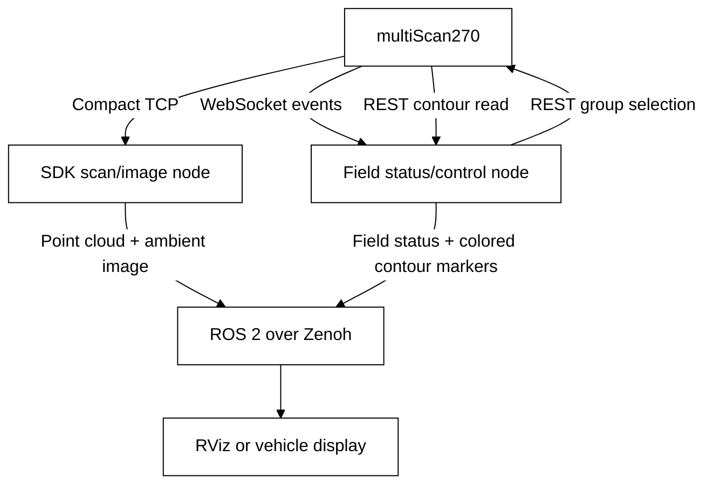

# ROS 2 Reversing Assistant with an Ambient-Light Image

> Level 3 multiScan270 project: publish SDK point clouds and ambient-light images over ROS 2 with Zenoh, receive field events, and select monitoring groups.

Source: https://sickag.github.io/sick_lidar_developer_guide/beginner-projects/ros2-reversing-assistant-camera/

# ROS 2 Reversing Assistant with an Ambient-Light Image

Compatible with: multiScan200

<div class="tool-intro" markdown>


This Level 3 project combines a multiScan270, an SDK-based ROS 2 wrapper,
asynchronous field status, and an ambient-light view in RViz or another
ROS-connected display.

</div>

## Application Background

A reversing assistant should show the area behind a vehicle and indicate
whether the selected monitoring field is occupied. The operator switches
between a close-range field for confined spaces and a wider monitoring field.
The display must show the **confirmed** group, not just the requested mode.


*Application illustration: an obstacle warning and a view of the reversing area help the driver assess the situation.*

The multiScan270 provides a grayscale ambient-light image, not an RGB camera
stream. Publish it as a ROS image so a display can show it alongside the point
cloud and field status.


*Ambient-light image example supplied for this project. The same type of image can be streamed through a ROS Image topic to RViz or a vehicle display; this picture is illustrative, not a capture from the current live session.*

This prototype is a warning aid, not a safety function. Do not connect it to
braking, steering, or motion authorization. Missing data, inactive fields, and
disconnected communication must appear unavailable, never as a clear reversing area.

## Before You Start

- Use a supported ROS 2 installation with compatible `rmw_zenoh_cpp`, RViz,
  colcon, and C++17 build tools. The architecture does not require a particular
  ROS distribution; match compiler, Python, and runtime libraries to your installation.
- Use SDK 2.0.0 or a compatible newer release with the multiScan200 driver.
  Keep SDK build and dependency setup separate from the ROS workspace.
- Configure the two existing fields in **different TELEGRAM-controlled groups**.
  Follow [Field Evaluation](https://sickag.github.io/sick_lidar_developer_guide/on-device-applications/field-evaluation/#activate-and-monitor-a-group)
  rather than recreating the configuration procedure here. Record evaluation IDs,
  group IDs, and result-list positions separately; confirm which volume is near/wide.
- Enable ambient data in Compact type 6 without overwriting other output options.
  Check `compactTelegramType6Content` in the
  [multiScan200 REST reference](https://sickag.github.io/sick_lidar_developer_guide/multiScan200/rest-api-openapi/).
- Use the [WebSocket Events](https://sickag.github.io/sick_lidar_developer_guide/data-streaming/websocket-events/) registration
  pattern for `FieldEvaluationResult`; verify support on the target device.
  Offer compression, but do not require it when the server does not negotiate it.

{ width="50%" }
*Configuration example: retain the existing field geometry and assign each monitoring volume to its own selectable group.*

{ width="50%" }
*Field-group example: name the group <strong>Close Range</strong> and select <strong>Telegram</strong> activation so the application can control it. <strong>Initially active</strong> defines its startup state; the screenshot shows it enabled. Configure the wide-range field in a separate group and verify both groups' startup states before selecting a mode.*

## Suggested Data Path

Unlike [native ROS 2 integration](https://sickag.github.io/sick_lidar_developer_guide/integration-notes/ros-integration/#native-ros-2),
this approach receives Compact data through the host SDK and publishes ROS
messages itself. Zenoh transports those messages; it does not replace the
device's TCP, WebSocket, or REST interfaces.



*Reversing-assistant data path: the SDK publishes point clouds and ambient-light images, while a separate node handles field events and REST control. ROS 2 over Zenoh carries the data to RViz or a vehicle display.*

The wrapper publishes `points` (`PointCloud2`), `ambient_light` (`Image`),
`field_states` (both evaluations with validity/activity), `field_markers`
(`MarkerArray` volumes colored by live state), and `diagnostics`
under `/sick_multiscan200_node`. A `select_field_group` service selects
`near` or `wide`, verifies REST success and group readback, then waits for a
fresh event snapshot before declaring field results current.

## Example Solution


*RViz example: field volumes read through REST are overlaid on the SDK point cloud. Live field events color evaluation 1 green (FREE) and evaluation 2 red (INFRINGED); colors change with the reported state.*

Use the following **single prompt** to build the wrapper in your own workspace.
Its phases also separate the reusable scan/image wrapper from field control.

<details>
<summary>Expand the complete project prompt</summary>

```markdown
# Build an SDK-Based ROS 2 Reversing Assistant

Create an OS-neutral multiScan270 warning prototype. Use sick_perception_sdk
2.0.0 or a compatible newer release, not the sensor's native ROS publisher.
Use the installed ROS 2 distribution with matching rmw_zenoh_cpp and RViz;
do not require migration to a named distribution. Inspect the actual SDK
headers and device OpenAPI instead of guessing APIs or firmware capabilities.

## Phase 1: Workspace and Interfaces

Create a C++17 ament_cmake package sick_multiscan200_node for SDK reception
and custom ROS interfaces. Use a separate Python rclpy package
sick_multiscan200_events with an asyncio WebSocket/REST client so network
control never blocks scan callbacks. Deliver launch, YAML and RViz files.
Keep the SDK and ROS sources unchanged.

Parameters: sensor_address, scan_port (default 2115), frame_id (lidar),
mirror_image, publish_identity_tf (false), mapping_verified (false),
and separate near/wide evaluation IDs, group IDs and zero-based result indexes.
Validate all values. Require verified mapping before trusting field status
or enabling switching; do not infer group IDs from evaluation IDs.

Publish under /sick_multiscan200_node:
- points: sensor_msgs/PointCloud2
- ambient_light: sensor_msgs/Image
- field_states: custom FieldStateArray
- field_markers: visualization_msgs/MarkerArray
- diagnostics: diagnostic_msgs/DiagnosticArray
- select_field_group: custom service, string mode -> success/message/group ID

Each FieldState includes evaluation_id, group_id, raw_state, valid, active,
and reason. Use reliable KeepLast(5) for scan/image and reliable
transient-local KeepLast(1) for status. Report scan/image/event health separately.

## Phase 2: SDK Point Cloud

Use sick::multiScan200::Driver and scanDataReceiver().setup(scan_port).
Attach an explicitly typed UnorganizedPointCloud callback plus a raw
MultiScan200Data callback; the SDK multiplexes them. Enable Cartesian
coordinates, intensity, time offsets, ring, layer and echo indexes.

Map SDK fields/offsets/types to PointCloud2, preserve meter scaling and
sensor acquisition time, and validate sizes, byte counts and endian order.
ROS PointField has no Int64/Uint64: reject them or numerically repack;
never relabel integer bytes as FLOAT64. Handle timestamp overflow explicitly.

## Phase 3: Ambient Image and RViz

Read type-6 ambientLightData and its actual metadata dimensions. Convert
column-major samples to row-major mono16, with step=width*2 and explicit
little-endian bytes. Mirror horizontally only when mirror_image is enabled.
Preserve sensor time and raw pixel values. Reject malformed/partial frames;
skip missing image data with a diagnostic, never synthesize an image.

Configure RViz PointCloud2 and Image displays, reliable QoS and fixed frame
lidar. Normalize only the displayed image. Do not use Camera without
CameraInfo or invent calibration. Leave map-to-sensor identity TF disabled;
moving vehicles require real mounting/localization transforms and clock sync.

## Phase 4: Field Events and Group Selection

Register FieldEvaluationResult at ws://<sensor_address>/apievents using
the documented event envelope. Handle both initial registration data and
subsequent events. Offer permessage-deflate, accept an uncompressed session,
and explicitly report unsupported registration or malformed data.

Preserve raw device states. Only a current FREE result for a confirmed
active group is clear; inactive, unknown, disconnected or pending is not.
Keep transition states as warnings. Reconnect with bounded backoff,
resubscribe and invalidate old results until a fresh snapshot arrives.
A quiet healthy subscription is not automatically stale.

The near/wide service touches only the two configured groups. Serialize
requests, mark status pending, check HTTP and device response headers and
every activation result, then verify target active/other inactive by readback.
Do not assume switching is atomic. Discard old in-flight results and obtain
a fresh subscription snapshot after switching. Monitor external group
changes even while field events continue arriving.

Read each evaluation's contour and configuration through the REST API,
using the documented authentication without storing credentials in the
workspace. Convert polygon coordinates and lower/upper Z limits from
millimeters to meters in the sensor frame. Publish the actual field volumes
as RViz markers, with green for FREE, red for INFRINGED, amber for transition
states, gray for inactive and a distinct unknown indication on invalid or
disconnected data. Show evaluation IDs and state labels. Never invent
geometry when access is denied; report the error and request authentication.

## Phase 5: Build and Run

Provide Windows and Linux build/environment instructions, a combined launch
file, YAML configuration and RViz layout. Match SDK/ROS compiler runtimes
(including /MD on Windows) and stop/join workers cleanly on shutdown.
Start a Zenoh router and use the same middleware/domain in all terminals.
Do not create/delete fields, write EEPROM or change network settings.
Keep verification scripts, captures and test reports local, outside the guide.
Explain clock synchronization, field-mapping and scene-orientation checks.
```

</details>

## Run and Display

After building the generated packages, activate ROS and your workspace in
every terminal. Select the same middleware and domain for all processes:

=== "Windows PowerShell"

    ```powershell
    $env:RMW_IMPLEMENTATION = "rmw_zenoh_cpp"
    $env:ROS_DOMAIN_ID = "187"
    ros2 run rmw_zenoh_cpp rmw_zenohd
    ```

=== "Linux"

    ```bash
    export RMW_IMPLEMENTATION="rmw_zenoh_cpp"
    export ROS_DOMAIN_ID="187"
    ros2 run rmw_zenoh_cpp rmw_zenohd
    ```

Use an available router endpoint and a domain appropriate for your system.
In another activated terminal, launch with your edited YAML path; the launch
file must load it for both nodes. In a third, open the generated RViz layout.
These relative paths assume the generated workspace is the working directory:

```bash
ros2 launch sick_multiscan200_node multiscan200.launch.py \
  config:="$PWD/src/sick_multiscan200_node/config/reversing_assistant.yaml"
rviz2 -d src/sick_multiscan200_node/rviz/reversing_assistant.rviz
```

On PowerShell, use native paths and its continuation syntax instead:

```powershell
ros2 launch sick_multiscan200_node multiscan200.launch.py `
  "config:=$PWD\src\sick_multiscan200_node\config\reversing_assistant.yaml"
rviz2 -d .\src\sick_multiscan200_node\rviz\reversing_assistant.rviz
```

The **Image** display subscribes to `/sick_multiscan200_node/ambient_light`.
A custom vehicle display can subscribe to that same topic. Keep **Fixed Frame**
at `lidar` for the stationary example; the ambient view is not a calibrated
overlay on the point cloud.

Inspect status and request a group using the generated interfaces:

```bash
ros2 topic echo --once /sick_multiscan200_node/field_states
ros2 service call /sick_multiscan200_node/select_field_group \
  sick_multiscan200_node/srv/SelectFieldGroup "{mode: near}"
```

```powershell
ros2 service call /sick_multiscan200_node/select_field_group `
  sick_multiscan200_node/srv/SelectFieldGroup "{mode: wide}"
```

Confirm the returned group and current field status. Before vehicle use,
check actual near/wide geometry, sensor clock synchronization and image
orientation with an asymmetric scene. Do not change a working installation
or persistent sensor settings merely to follow the example.
