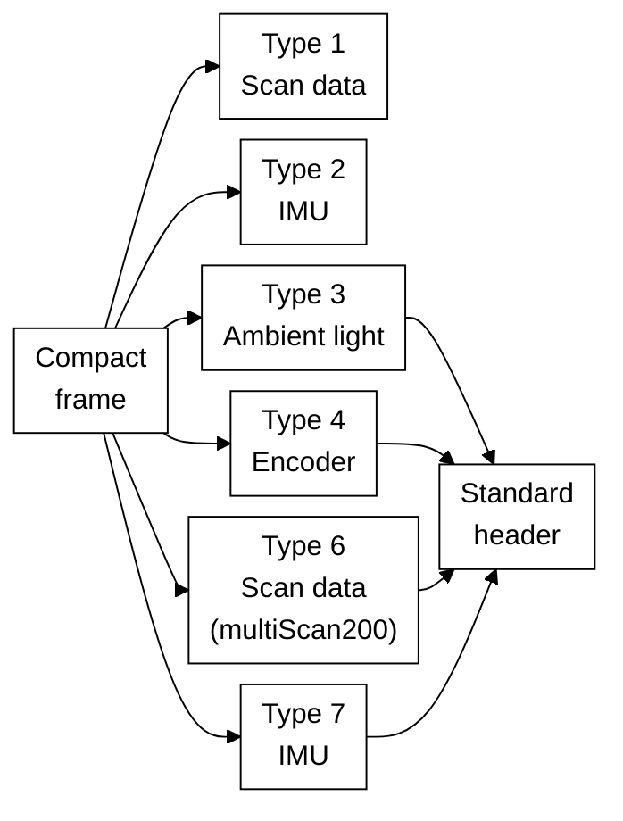

# SICK Compact Format: Parse LiDAR Scan, IMU, Encoder Data

> Parse the SICK Compact binary format over UDP or TCP: frame layout, scan telegrams, IMU and encoder data, multiScan200 formats, and Wireshark decoding.

Source: https://sickag.github.io/sick_lidar_developer_guide/data-streaming/compact-format/

# Compact Format

Compatible with: LRS4000 multiScan100 multiScan200 picoScan100

The Compact format is SICK's binary format for measurement data. It uses the least bandwidth of all formats and can be parsed very efficiently, for example by copying the bytes into a C struct with `memcpy`. The fields are not self-describing: your parser must know the layout, which SICK publishes as [Kaitai Struct](https://kaitai.io/) definitions.

The multiScan100 and picoScan100 send each scan segment in a UDP datagram.
The LRS4000 and multiScan200 carry it as a framed telegram in the TCP stream.
Every segment can be processed on its own, which keeps latency low. To work
with a full scan (frame), collect all segments with the same `frame_number`.

To inspect a captured telegram field by field, paste it into the free, browser-based [Kaitai Web IDE](https://ide.kaitai.io/) together with the definitions below.
To generate a parser for your own application, see [Kaitai Struct Parsers](https://sickag.github.io/sick_lidar_developer_guide/integration-notes/kaitai-struct-parsers/).

The Compact format is organized as one frame definition that dispatches to the
individual telegram types. Types 3, 4, 6, and 7 also share the standard header:



*Compact parser structure: the frame definition selects the telegram-specific parser. Types 3, 4, 6, and 7 reuse the standard header definition.*

The authoritative Kaitai Struct definitions are in the [`formats` folder on GitHub](https://github.com/SICKAG/KaitaiStructDescriptions/tree/public/formats). Use those files for the complete field layout instead of copying a format definition into this page.

To receive Compact data without writing your own parser, use the C++ [sick_perception_sdk](https://sickag.github.io/sick_lidar_developer_guide/recording/sick-perception-sdk/). It receives the scan, IMU, and encoder data and provides the scans as point clouds.

## Frame Layout

All multi-byte values are little-endian. The frame contains a start marker, a
telegram type, the type-specific payload, and a CRC32 checksum. Verify the
checksum before processing the payload. Use the authoritative
[`compact_frame.ksy` definition on GitHub](https://github.com/SICKAG/KaitaiStructDescriptions/blob/public/formats/compact_frame.ksy)
for the complete frame layout.

## Standard Header

Telegram types 3, 4, 6, and 7 start their payload with the same header. Types
1 and 2 do not. For the complete field layout, use the authoritative
[`compact_header.ksy` definition on GitHub](https://github.com/SICKAG/KaitaiStructDescriptions/blob/public/formats/compact_header.ksy).

For type 4 with `telegram_version` 1, `payload_length` includes `sender_id`; from version 2 onwards it does not.

## Type 1: Scan Data

The scan payload is a header followed by one or more modules. Each module carries per-layer metadata plus the beam data for its layers. Read the first module size from the telegram header, then use each module's `next_module_size` to find the next one; zero marks the last module. Do not assume all modules have the same size.

Read `telegram_version`, `data_content_echos`, and `data_content_beams` before parsing beam data. Versions 3 and 4 have different beam-field ordering; version 4 also adds a distance scaling factor to the module metadata. For version 4, convert a raw distance to millimeters as `distance_mm = distance_raw × distance_scaling_factor`. All segments of one scan share `frame_number` and differ by segment index. The authoritative definition is [`type_1_primary_data_spherical_coordinates.ksy` on GitHub](https://github.com/SICKAG/KaitaiStructDescriptions/blob/public/formats/type_1_primary_data_spherical_coordinates.ksy).

Scan angles describe an individual beam's direction in the sensor's scan
coordinate system. They are not the sensor's orientation angles measured by
the IMU. The protocol field names `phi` and `theta` are retained here so you
can match the explanation to your parser.

<p class="table-caption">Beam angles, Cartesian point coordinates, and sensor-orientation terms used on this page.</p>

| Quantity | Meaning |
| --- | --- |
| `phi` (elevation) | Beam angle above or below the scan coordinate system's XY plane |
| `theta` (azimuth) | Beam angle in the XY plane, measured from +X towards +Y |
| `d` | Measured distance along the beam |
| `x`, `y`, `z` | Cartesian coordinates of the measured point in the scan coordinate system |
| Roll, pitch, yaw | Sensor-orientation angles describing rotations about the IMU's X, Y, and Z axes, respectively |

Beam elevation is not IMU pitch, and beam azimuth is not IMU yaw. Converting a
beam to Cartesian coordinates does not by itself transform the point into a
world coordinate system.

To convert a beam to a 3D point, use `phi` (elevation), `theta` (azimuth), and the distance `d`:

```txt
x = d · cos(phi) · cos(theta)
y = d · cos(phi) · sin(theta)
z = d · sin(phi)
```

### Measurement Data Conventions

#### Azimuth Angles

The `theta` values within a segment are monotonically
increasing. For a 360° sensor, a segment that crosses the +180°/−180° boundary
can therefore continue beyond 180° instead of wrapping immediately to a
negative value. In the example below, the blue segment runs from 160° to 189°,
while the following green segment uses −170° to −141°. Preserve this ordering
while parsing; normalize the angles only afterwards if your application needs
the range (−180°, 180°].

{ width="360" }
*Azimuth values remain monotonically increasing within a segment.*

#### Segment Counters

Normally, the segment counter is between `0` and
`number_of_segments - 1` and increases with the azimuth. The multiScan100 has
one exception: when most beams in a segment lie beyond 180°, that segment
belongs to the next frame and receives counter `0`. With 30° segments, an
angle-only calculation would produce counter `12`, which wraps to `0`. Use the
transmitted counter rather than deriving it from `theta`.

{ width="480" }
*The blue segment belongs mainly to the next frame and therefore receives counter 0.*

#### RSSI Values

Compact and MSGPACK represent RSSI as a dimensionless 16-bit
unsigned integer. Treat the full range from `0` to `65535` as valid, although a
device may never reach the maximum. RSSI is not standardized, so absolute
values are not directly comparable between device families.

Some device outputs scale an internally measured 8-bit RSSI value depending on
the output format:

<p class="table-caption" markdown>**RSSI Values:** format, bit depth, and conversion.</p>

| Format | Bit depth | Conversion |
| --- | --- | --- |
| Compact type 1 | 16-bit | `16bit = (8bit / 255) × 65535` |
| MSGPACK | 16-bit | `16bit = (8bit / 255) × 65535` |
| `LMDscandata` (CoLa) | 8-bit | none; value `254` = reflector detected; this representation is compatible with TiM5/7 |

For example, an internal 8-bit value of `1` becomes `257` (`0x0101`) in
16-bit output. The low byte equals the high byte (for example `0xe6e6`), which
is expected.

#### Bit Fields and Beam Properties

`data_content_echos`,
`data_content_beams`, and each beam's `properties` value are bit fields. Test
bit `i` with `(value & (1 << i)) != 0`; do not interpret the complete decimal
value as a single state. In `properties`, bit 0 means that a reflector was
detected for at least one echo of the beam. This can be treated as applying to
the last echo because a reflector echo is not physically followed by another
echo on the same beam. Bits 1 through 7 are reserved and must be ignored.

### Segments (LRS4000)

LRS4000 sends one Compact scan telegram per frame. The `DataOutputRange`
setting replaces measurements outside the selected angles with zeros; it does
not reduce the telegram size.

### Segments (picoScan100)

The picoScan100 scans a range of 276°. One 276° rotation of the scan layer is one scan (frame). For output, each scan is split into segments of a fixed angular size:

<p class="table-caption" markdown>**Segments (picoScan100):** scanning frequency, segment size, and segments at 276°.</p>

| Scanning frequency | Segment size | Segments at 276° |
| --- | --- | --- |
| ≤ 25 Hz | 30° | 10 |
| ≥ 30 Hz | 60° | 5 |


*Example of 30° scan segments within the 276° scan range.*

Segment boundaries do not move when you reduce the scan range. Measured values in hidden angle ranges are filled with zeros, and a segment that is completely hidden is not sent. Example: 180° (−90° to +90°) at 40 Hz gives 4 segments.

### Segments (multiScan100)

The multiScan100 captures a 360° frame across its scan layers and divides the
output into time-based segments. Each segment contains data from all scan
layers, but the azimuth ranges of those layers do not necessarily line up
spatially. Raw output keeps the original layer timing. Rectified output aligns
the layer start angles as closely as possible and adds at least one segment
interval of latency. See the [multiScan100 overview](https://sickag.github.io/sick_lidar_developer_guide/multiScan100/)
for device-specific output context.


*A 360° frame split into twelve 30° segments, each with its own time stamp.*

Each segment covers a different time within the rotation, so `t0` to `t11`
increase in the scan direction. Use the per-segment time stamps rather than the
frame time when you fuse the data with motion or another sensor.

## Type 2: IMU

A flat, fixed-size payload from the integrated inertial measurement unit. It
has no standard Compact header and no optional fields. IMU output is available
on multiScan100 and picoScan100; sampling and available fields depend on the
product. The LRS4000 provides IMU data through CoLa events or
`GET /api/InertialMeasurementUnit`, not as a Compact telegram. The authoritative Compact layout is
[`type_2_imu.ksy` on GitHub](https://github.com/SICKAG/KaitaiStructDescriptions/blob/public/formats/type_2_imu.ksy).

The data is specified in the following coordinate system based on the DIN 70000
system: The x-axis lies on the 90° beam of the 0° plane. The y-axis is
perpendicular to the x-axis and lies in the 0° plane. The y-values increase in
the counter rotation direction (right-handed system). The z-axis is
perpendicular to the y-axis and the top of the device points towards increasing
z-values.

The following figure shows the IMU axes and positive rotation directions:
roll about X, pitch about Y, and yaw about Z. These describe sensor
orientation, not the beam elevation `phi` or azimuth `theta` used in the
[scan-point conversion](https://sickag.github.io/sick_lidar_developer_guide/data-streaming/compact-format/#type-1-scan-data).

{ width="520" }
*IMU axes and roll, pitch, and yaw rotation directions based on DIN 70000; these are distinct from scan-beam angles.*

## Type 3: Ambient Light

The ambient-light image of the multiScan200 is sent as a separate telegram.
The sensor captures it passively through the same receiver as the distance
data. It follows the [standard header](https://sickag.github.io/sick_lidar_developer_guide/data-streaming/compact-format/#standard-header). Use the
authoritative definition linked below for its payload layout.

Distance and ambient-light data measured at the same time share the same
`frame_number`. Use the authoritative
[`type_3_ambient_light.ksy` definition on GitHub](https://github.com/SICKAG/KaitaiStructDescriptions/blob/public/formats/type_3_ambient_light.ksy)
for the complete payload layout.

## Type 4: Encoder

Reports an external rotary encoder attached to a moving axis (picoScan150).
One encoder telegram is sent per scan frame and linked to it by `frame_number`.
It follows the [standard header](https://sickag.github.io/sick_lidar_developer_guide/data-streaming/compact-format/#standard-header). Use the authoritative
definition linked below for its payload layout.

See [3D With 2D LiDARs](https://sickag.github.io/sick_lidar_developer_guide/integration-notes/3d-with-2d-lidars/) for how to fuse encoder and scan data.

Use the authoritative [`type_4_encoder.ksy` definition on GitHub](https://github.com/SICKAG/KaitaiStructDescriptions/blob/public/formats/type_4_encoder.ksy) for the complete payload layout.

## Type 6: Scan Data (multiScan200)

The scan data of the multiScan200. One telegram carries one segment: a block
of columns (slots), each with all layers. It follows the [standard
header](https://sickag.github.io/sick_lidar_developer_guide/data-streaming/compact-format/#standard-header). Use the authoritative definition linked below for
the complete segment header and data-block layout.

Convert each pixel to a 3D point with the [formula for type 1](https://sickag.github.io/sick_lidar_developer_guide/data-streaming/compact-format/#type-1-scan-data), using the elevation angle of its layer as `phi` and the azimuth angle of its column as `theta`. Use the authoritative [`type_6_primary_data_multiscan200.ksy` definition on GitHub](https://github.com/SICKAG/KaitaiStructDescriptions/blob/public/formats/type_6_primary_data_multiscan200.ksy) for the complete segment header and data-block layout.

For interlaced scan configurations, `number_of_interlace_steps` is greater than 1 and consecutive frames must be combined to cover the full field of view; `current_interlace_index` identifies each frame's position in that sequence. Configured data reduction can also leave zero-filled distance and RSSI values in the fixed-size Compact segment, including for angles outside the selected range. A zero value alone therefore does not mean that the beam or column is absent.

## Type 7: IMU with Standard Header

The IMU data of the multiScan200. The content matches [type 2](https://sickag.github.io/sick_lidar_developer_guide/data-streaming/compact-format/#type-2-imu), but the payload starts with the [standard header](https://sickag.github.io/sick_lidar_developer_guide/data-streaming/compact-format/#standard-header) and has no `telegram_version` field of its own:

Use the authoritative [`type_7_imu_standard_header.ksy` definition on GitHub](https://github.com/SICKAG/KaitaiStructDescriptions/blob/public/formats/type_7_imu_standard_header.ksy) for the complete payload layout.

## Transport

<p class="table-caption" markdown>**Transport:** transport, formats and devices, connection, delivery guarantee, and best for.</p>

| Transport | Formats and devices | Connection | Delivery guarantee | Best for |
| --- | --- | --- | --- | --- |
| UDP unicast | Compact, MSGPACK (multiScan100); Compact, MSGPACK (picoScan100) | Sensor sends to one host | None; packets can be lost or reordered | Low-latency data to one host |
| UDP multicast | Compact (multiScan100); Compact, MSGPACK (picoScan100) | Sensor sends one stream to a group | None; packets can be lost or reordered | The same data to several hosts |
| TCP | Compact (LRS4000 and multiScan200); [LMDscandata](https://sickag.github.io/sick_lidar_developer_guide/data-streaming/lmdscandata-format/) where supported | Client connects to a device-specific data port or CoLa port | Ordered and error-checked | Data integrity over latency; PLCs |

For UDP, select the required format in the data-output settings and set the
destination IP address and port. For multiScan100 and picoScan100, the REST
API exposes Ethernet destination settings for the scan data stream. The
picoScan100 factory default is `192.168.0.100:2115`.

<!-- SICK video: 0_6tjpjd8d; source: https://support.sick.com/sick-knowledgebase/article?id=4a51d85b-bb4e-f011-877b-000d3a2a3508 -->
*picoScan100 example: Enable Compact measurement data over UDP unicast and set the receiver destination address. This workflow does not apply to the TCP-only multiScan200 transport.*

The multiScan200 sends Compact data over TCP to avoid data loss, on separate
ports per content:

<p class="table-caption" markdown>**Transport:** TCP port, content, and telegram type.</p>

| TCP port | Content | Telegram type |
| --- | --- | --- |
| `2115` | Distance and RSSI, optionally with ambient light | [6](https://sickag.github.io/sick_lidar_developer_guide/data-streaming/compact-format/#type-6-scan-data-multiscan200) |
| `2116` | Ambient light only | [3](https://sickag.github.io/sick_lidar_developer_guide/data-streaming/compact-format/#type-3-ambient-light) |
| `2117` | IMU | [7](https://sickag.github.io/sick_lidar_developer_guide/data-streaming/compact-format/#type-7-imu-with-standard-header) |

Select **TCP Compact** as data output mode (`sWN dataOutputMode 1`); see the [multiScan200 CoLa Telegram Listing](https://sickag.github.io/sick_lidar_developer_guide/multiScan200/cola-telegram-listing/#set-data-output-mode-swn-dataoutputmode).

The LRS4000 `ScanDataFormat` REST parameter supports Compact output. The
Compact stream uses TCP, with port `2115` as the Compact data port.

For multicast, set the destination to a multicast address in the range `224.0.0.0` to `239.255.255.255`. Every receiving host joins the same group and listens on the configured UDP port. The sensor sends each packet only once, however many hosts receive it. Make sure that switches and routers forward multicast traffic, and use IGMP snooping when several receivers are connected. See [UDP Unicast / Multicast](https://sickag.github.io/sick_lidar_developer_guide/shared-features/udp-unicast-multicast/) for a comparison of the transports.

## Sample Packet Captures

Open these one-second `.pcap.gz` recordings directly in Wireshark with the
[Compact dissector](https://sickag.github.io/sick_lidar_developer_guide/data-streaming/compact-format/#wireshark-dissector). All recordings contain only measurement traffic,
with original packet bytes and timestamps.

In every sample, `192.168.0.1` is the sensor and `192.168.0.100` is the
receiver; your PC does not need matching addresses for offline inspection.
The tables describe recorded settings, not required defaults.

Enable IPv4 reassembly for UDP and TCP stream reassembly for TCP.
UDP scan frames can be partial at the recording boundaries; group segments
by `frame_number`. For TCP, use **Follow TCP Stream**: a telegram spans
multiple packets. Reference pictures show scene context, not synchronized
PCAP frames.

<p class="table-caption">Compact sample availability and transport by device family.</p>

| Device family | Sample | Compact transport |
| --- | --- | --- |
| LRS4000 | [LRS4000 scan capture (gzip PCAP, 605 KB)](https://sickag.github.io/sick_lidar_developer_guide/assets/data-streaming/lrs4000-compact-scan-tcp.pcap.gz) | TCP |
| multiScan100 | [multiScan165 scan and IMU capture (gzip PCAP, 1.16 MB)](https://sickag.github.io/sick_lidar_developer_guide/assets/data-streaming/multiscan165-compact-scan-imu-udp.pcap.gz) | UDP unicast |
| multiScan200 | [multiScan270 scan, ambient-light, and IMU capture (gzip PCAP, 13.4 MB)](https://sickag.github.io/sick_lidar_developer_guide/assets/data-streaming/multiscan270-compact-scan-ambient-imu-tcp.pcap.gz) | TCP |
| picoScan100 | [picoScan150 scan, IMU, and encoder capture (gzip PCAP, 327 KB)](https://sickag.github.io/sick_lidar_developer_guide/assets/data-streaming/picoscan150-compact-scan-imu-encoder-udp.pcap.gz) | UDP unicast |

### LRS4000 Capture Settings


*LRS4000 reference view: planar scan points on a grid, with distance in meters.*

<p class="table-caption">LRS4000 settings and recorded TCP scan data.</p>

| Setting | Value in this recording |
| --- | --- |
| Device and firmware | LRS4581R-230001, firmware `1.10.0.0R` |
| Duration | 0.994874 s |
| Scan connection | Sensor TCP port `2115` → receiver port `49455`; Compact (`ScanDataFormat = 2`) |
| Scan configuration | 12.5 Hz, 0.04°; −180° to +180° |
| Scan geometry | One module, one layer, 9,000 beams, three echoes per frame |
| Scan telegrams | 13 complete type 1 telegrams, version 4; no partial telegrams |
| Filters | All echoes; particle, mean, median, and radial-distance filters disabled |
| Distance scale | `ScanDataScaleFactor = 2` |

Wireshark filter: `ip.addr == 192.168.0.1 && tcp.port == 2115`.

### multiScan165 Capture Settings


*multiScan165 reference view: scan points on a perspective grid, colored by echo.*

<p class="table-caption">multiScan165 settings and recorded UDP scan and IMU data.</p>

| Setting | Value in this recording |
| --- | --- |
| Device and firmware | multiScan165, firmware `2.5.0.0R` |
| Duration | 0.998802 s |
| Scan connection | Sensor UDP port `39493` → receiver port `2115`; Compact (`ScanDataFormat = 2`) |
| Scan configuration | 20 Hz, 0.5° angular resolution; configured azimuth range −180° to +180° |
| Recorded scan geometry | Two modules of eight layers each; 60 beams per layer per segment; three echoes; 12 segments per complete frame |
| Scan telegrams | 242 type 1 telegrams, version 4; 20 complete 12-segment frames and one partial frame |
| Echo filter | All echoes (`FREchoFilter = 1`) |
| Angle, layer, radial-distance, and interval filters | Disabled; all 16 layers selected |
| IMU connection and telegrams | Sensor UDP port `58362` → receiver port `7503`; 101 type 2 telegrams |

Wireshark filter:
`ip.src == 192.168.0.1 && (udp.dstport == 2115 || udp.dstport == 7503)`.

### multiScan270 Capture Settings


*multiScan270 reference view: SOPASair point cloud above the ambient-light image.*

<p class="table-caption">multiScan270 settings and recorded TCP scan, ambient-light, and IMU data.</p>

| Setting | Value in this recording |
| --- | --- |
| Device and firmware | multiScan270, firmware `1.1.0.0R` |
| Duration | 0.991826 s |
| Output mode | TCP Compact (`dataOutputMode = 1`) |
| Scan connection | Sensor `192.168.0.1:2115` to receiver port `59003`; 19 complete type 6 telegrams, version 1 |
| Scan content | Distance, RSSI, echo properties, and ambient light |
| Scan geometry | One segment per frame; 592 columns, 192 layers, three echoes; 192 ambient-light layers included |
| Performance profile | `12`: 20 Hz frame rate; four interlace steps per full scan (5 Hz full-scan rate) |
| Configured angular range and resolution | Azimuth −138° to +138°, 0.4662° per frame; elevation −22.5° to +22.5°, 0.2344° |
| Ambient-light connection | Sensor `192.168.0.1:2116` to receiver port `59004`; 19 complete type 3 telegrams, version 1; 592 × 192 pixels |
| Ambient-light vertical setting | Matching (`ambientPixelCountVertical = 1`), not full vertical pixel count |
| IMU connection | Sensor `192.168.0.1:2117` to receiver port `59005`; 97 complete type 7 telegrams, version 1 |
| Echo and particle filters | All echoes (`FREchoFilter = 1`); particle filter enabled, minimum one neighbor, `distanceThreshold = 500` |
| Other filters | Interval, angle-range/focus, and blooming filters disabled |
| Recording boundary | Scan and ambient-light streams each end partway through one additional telegram; these tails are not counted as complete telegrams |

Wireshark filter:
`ip.addr == 192.168.0.1 && (tcp.port == 2115 || tcp.port == 2116 || tcp.port == 2117)`.
Combine the four interlace indices before treating the scan as full coverage.

### picoScan150 Capture Settings

Encoder positions use fixed-velocity mode, not physical encoder measurements.


*picoScan150 reference view: planar scan points on an XY grid, with distance in meters.*

<p class="table-caption">picoScan150 settings and recorded UDP scan, IMU, and encoder data.</p>

| Setting | Value in this recording |
| --- | --- |
| Device and firmware | picoScan150, firmware `2.3.3.0R` |
| Duration | 0.999805 s |
| Scan connection | Sensor UDP port `52593` → receiver port `2115`; Compact (`ScanDataFormat = 2`) |
| Performance profile | `6`: 30 Hz, 0.1°; −138° to +138° |
| Echo filter | All echoes (`FREchoFilter = 1`); three echoes per beam |
| Angle, distance, interval, and averaging filters | Disabled |
| Scan telegrams | 150 type 1 telegrams, version 4; 29 complete five-segment frames and two partial frames |
| IMU connection and telegrams | Sensor UDP port `46180` → receiver port `7503`; 99 type 2 telegrams |
| Encoder connection and telegrams | Sensor UDP port `41656` → receiver port `7504`; 30 type 4 telegrams, version 1 |
| Encoder settings | Fixed velocity (`EncSetting = 4`); reported speed `1000`; `EncResolution = 1` |

Wireshark filter:
`ip.src == 192.168.0.1 && (udp.dstport == 2115 || udp.dstport == 7503 || udp.dstport == 7504)`.

## Wireshark Dissector

SICK provides a Wireshark dissector for Compact measurement and IMU data, so you can inspect the stream field by field instead of reading raw bytes. It supports the Compact format only. Use it to confirm framing, ports, CRCs, and decoded values before you debug your own parser.

### Install the Dissector

1. Download and install [Wireshark](https://www.wireshark.org/download.html).
2. Download the dissector: [COMPACT_Dissector.lua](https://sickag.github.io/sick_lidar_developer_guide/assets/data-streaming/COMPACT_Dissector.lua).
3. In Wireshark, open **Help > About Wireshark > Folders** and copy the file to the **Personal Lua Plugins** folder.
4. Restart Wireshark.

### Decode Compact Data

1. Configure the sensor to output Compact data. For multiScan100 and picoScan100, select UDP and set the destination to your PC's IP address and listening port. For LRS4000 and multiScan200, use the [TCP connection](https://sickag.github.io/sick_lidar_developer_guide/data-streaming/compact-format/#transport).
2. Open Wireshark and double-click the Ethernet interface connected to the sensor to start capturing.
3. Enter `compact` in the display-filter bar and press Enter. Decoded packets show `COMPACT` in the **Protocol** column.
4. Select a packet and expand the Compact tree in the packet-details pane. Inspect the telegram type, header, and measurement values, such as distance. For an IMU telegram, inspect acceleration and angular velocity instead.

For a trusted sensor network on Windows, check that the Ethernet network profile is Private and that the firewall permits the stream:

```powershell
Get-NetConnectionProfile
Set-NetConnectionProfile -InterfaceIndex 18 -NetworkCategory Private
```

Replace `18` with the interface index reported by `Get-NetConnectionProfile`.

If no Compact packets appear, clear the display filter first to check whether traffic arrives at all. Verify the sensor's output format, destination address, and port. If you use a non-default port, add it to the corresponding port list near the top of the Lua file, such as `CompactPorts` or `IMUPorts`, and restart Wireshark.

To disable the plug-in temporarily, choose **Analyze > Enabled Protocols** and clear its checkbox. See [Frame Layout](https://sickag.github.io/sick_lidar_developer_guide/data-streaming/compact-format/#frame-layout) for the telegram structure and [Wireshark | pcap](https://sickag.github.io/sick_lidar_developer_guide/recording/wireshark-pcap/) for recording traffic.

### IMU Example

Enable IMU output on a supported sensor and capture its IMU stream as well as the measurement stream. The video shows how to receive and inspect IMU telegrams in Wireshark.

<!-- SICK video: 0_jnvpbvv5; source: https://support.sick.com/sick-knowledgebase/article?id=aeac8012-be4e-f011-877b-000d3a2a3508 -->
*How to receive IMU data and dissect it with Wireshark.*

## Bandwidth Calculator

Estimate Compact scan frame sizes, segment counts, and network traffic for
supported devices and scan settings. The optional IMU and encoder estimates
model IMU output at 100 Hz independently of the scan rate and encoder output
once per scan frame.

<noscript>This calculator requires JavaScript.</noscript>
<div class="calculator" data-bandwidth-calculator>
<form class="calculator__form">
<p class="calculator__heading">Device and Compact Output</p>
</form>
<div class="calculator__results">
<p class="calculator__heading">Estimated Result</p>
<div data-bandwidth-results aria-live="polite"></div>
<p class="calculator__status" data-bandwidth-status data-state="info" aria-live="polite">Loading the calculator…</p>
</div>
</div>

Remarks:

* The calculator provides an estimate of bandwidth requirements. It considers scan data and selected IMU or encoder telegrams, but not additional configuration traffic.
* Ensure that your network infrastructure can handle the estimated bandwidth to avoid data loss or latency issues.
