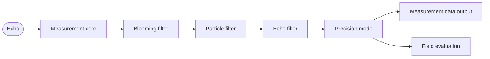

# multiScan200 Web GUI (SOPASair): All Screens and Settings

> Walkthrough of every multiScan200 SOPASair web interface screen, captured on a multiScan270: configuration, data output, contamination indication, and diagnostics.

Source: https://sickag.github.io/sick_lidar_developer_guide/multiScan200/graphical-user-interface/

# SOPASair Walkthrough

This page describes the multiScan200 web interface and the settings in each view. Use it to commission the sensor before you automate the configuration through the API. To try the interface without a device, open it in the [Virtual Sensor Lab](https://sickag.github.io/sick_lidar_developer_guide/simulation/virtual-sensor-lab/).

## Home

The Home page gives you the current device status, network identity, firmware version, and an overview of the sensor's operating state. It is usually the first screen you see after logging in and is the quickest place to confirm that the unit is online and healthy before you start changing configuration or application settings.

*Home page overview on a live multiScan270 device.*

The status bar at the top shows the LED indicator, the device connection status
and the measurement status. The toolbar next to it holds **Save permanently**,
the login panel, the language switch and the global help (**?**). The help
includes a **Getting started** tour that walks through the most important
commissioning steps.

Changes take effect immediately but are held in volatile memory. Click
**Save permanently** in the toolbar to store the parameter set in the device
and in the cloning memory of the system plug. Unsaved changes are lost at the
next power cycle.

For a monitoring display without configuration access, open
`http://192.168.0.1/#/?fullscreen=`.

*Status tile, captured live from a multiScan270.*

*Device information tile, captured live from a multiScan270.*

*Status of inputs tile, captured live from a multiScan270.*

*Status of outputs tile, captured live from a multiScan270.*

*Detection history statistics tile, captured live from a multiScan270.*

The LED indicator mirrors the four status LEDs on the housing. LED1 and LED3
show the same colour, as do LED2 and LED4.

Status LED combinations and their meanings on the multiScan270.

| LED1/LED3 | LED2/LED4 | Meaning |
| --- | --- | --- |
|  Red |  Red | Booting, parameterising or firmware update |
| – | – | Off |
|  Red, flashing fast |  Red, flashing fast | Fatal error |
|  Red, flashing slowly |  Red, flashing slowly | Recoverable error |
|  Green |  Green | Ready, no object detected in configured fields |
| – |  Green | Ready, no fields configured |
|  Red |  Yellow | Standby / power saving |
|  Green |  Yellow, flashing | Warning |
|  Yellow |  Green, flashing | Restart after time or digital input |
|  Green |  Yellow, flashing | Contamination warning |
|  Red, flashing |  Yellow, flashing | Contamination error |
|  Green, flashing |  Red, flashing | Alignment mode |
|  Green, yellow, red |  Green, yellow, red | Identify device (**Find device**) |
|  Red |  Red and yellow, flashing | Teach-in environment |
|  Yellow |  Green | Object detected |

 illuminated ·  flashing · – off

The LEDs are only an additional visual aid. Switching them off in the web
interface does not affect diagnostics over Ethernet or the digital I/Os.

## Configuration

Choose the scan configuration and the core measurement behaviour. Resolution, frequency, and range trade off against each other.

The live scan on the left updates as you change the configuration, which is the quickest way to judge a setting.

### Basic Settings

Basic Settings controls the scan configuration used by the sensor. The settings
are shown on the right; the live scan on the left shows the effect of the
selected frequency, angular resolution, and other settings immediately. Use
this view to check coverage and measurement behaviour while commissioning.

*Basic settings tile, captured live from a multiScan270.*

The multiScan270 offers the following scan configurations. The vertical field of
view is always 45° (about +22.5° to −22.5°). Configurations 10 to 12 reach their
horizontal resolution in interlaced mode, where consecutive scans are offset in
angle and combined. The ambient-light image is passively captured by the same
receiver used for LiDAR, synchronized with the laser measurement, and has the
same scan frequency and horizontal resolution as the configured laser
measurement.

multiScan270 scan configurations, angular resolutions, layer counts, ambient-image dimensions, and scan frequencies.

| No. | Use case                    | FoV (H) | Resolution (H × V) | Layers | Ambient image (pixels, columns × rows) | Frequency            |
| --- | --------------------------- | ------- | ------------------ | ------ | -------------------------------------- | -------------------- |
| 1   | Default                     | 276°    | 0.47° × 0.47°      | 96     | 592 × 96                               | 20 Hz                |
| 2   | Less bandwidth, more range  | 276°    | 0.47° × 0.94°      | 48     | 592 × 48                               | 20 Hz                |
| 3   | Highest vertical resolution | 276°    | 0.47° × 0.23°      | 192    | 592 × 192                              | 20 Hz                |
| 4   | Full 360° view              | 360°    | 0.47° × 0.47°      | 96     | 773 × 96                               | 10 Hz                |
| 10  | High horizontal resolution  | 276°    | 0.23° × 0.47°      | 96     | 1184 × 96                              | 20 Hz, 2× interlaced |
| 11  | High H and V resolution     | 276°    | 0.23° × 0.23°      | 192    | 1184 × 192                             | 20 Hz, 2× interlaced |
| 12  | Highest H and V resolution  | 276°    | 0.12° × 0.23°      | 192    | 2369 × 192                             | 20 Hz, 4× interlaced |
| 20  | Up to +55 °C                | 190°    | 0.47° × 0.47°      | 96     | 408 × 96                               | 20 Hz                |
| 21  | Up to +60 °C                | 120°    | 0.47° × 0.47°      | 96     | 285 × 96                               | 20 Hz                |

- **Configurations 20 and 21** reduce the horizontal field of view so that the
  device can operate at higher ambient temperatures (up to +55 °C and +60 °C).
- **Ambient image:** a passive, narrow-band image around 905 nm from the LiDAR
  receiver, not a camera image. Brightness can differ from what you see; for
  example, LED-lit areas may look dark. The table shows the image size that
  matches the point cloud. The maximum image size is 592 × 192 px
  (configurations 1 to 3), 773 × 192 (4), 1184 × 192 (10 and 11),
  2369 × 192 (12), 408 × 192 (20), and 285 × 192 (21).
- **Interlaced configurations (10 to 12):** 10 and 11 combine 2 scans (about
  100 ms at 20 Hz), 12 combines 4 (about 200 ms). This is the acquisition
  span, not the output latency. Because the points of one frame are captured
  at different times, moving objects can appear offset; for moving scenes,
  validate the result or use a non-interlaced configuration. The mean filter
  has no effect, and the particle filter should be checked because it compares
  measurements at different angles.
- **Small objects** must be hit repeatedly for reliable measurement. Objects
  below the minimum object size may need a stationary sensor and target.

*Date and system time tile, captured live from a multiScan270.*

**Date and system time**

The time base can be set using various methods:

- Explicitly setting the time with date, time
- Transferring the time from the computer used
- Via an external NTP server (Network Time Protocol) that is accessible in the network.
- Via an external PTP (Precision Time Protocol) master that is accessible in the network.

NTP uses UDP port 123 and PTP uses UDP ports 319/320. Both are inactive by
default. Use PTP when point clouds must be fused with other sensors, because it
gives the tightest synchronisation. For background and setup, see
[Time synchronization](https://sickag.github.io/sick_lidar_developer_guide/shared-features/time-synchronization/).

### Filter

Clean up the scan before it leaves the sensor by suppressing extra echoes, artefacts and airborne particles.

*Example filter settings in the multiScan270 web interface. Select parameters according to the requirements of each application.*

Filters can be combined freely. Active filters run one after another, each on
the result of the previous one, in this order: blooming filter, particle
filter, echo filter, precision mode. Keep in mind:

- Filters apply to both measurement data output and field evaluation. Filtered
  values cannot be converted back into the original measurements.
- Each active filter adds processing time and therefore output latency. The
  particle filter adds a delay of one scan.
- Field evaluation always uses a single echo. If the echo filter is set to
  **All echoes**, field evaluation uses the first echo.
- In interlaced scan configurations (10 to 12), the precision mode has no
  effect, and the particle filter compares measurements from different angular
  positions. Check that it still works as intended in your application.

The signal path through the filters:

*Filter processing order for measurement data output and field evaluation.*

The precision mode is the multiScan200 version of the mean filter.

For detailed behavior and examples, see [Filter details](https://sickag.github.io/sick_lidar_developer_guide/data-streaming/filter-details/).

### Inertial Measuring Unit (IMU)

Use the IMU view to inspect the sensor's current orientation and acceleration.

*Live capture from a multiScan270's web interface.*

*Inertial measuring unit (IMU) tile, captured live from a multiScan270.*

The IMU view displays the yaw, pitch, and roll angles in degrees, together with the measured acceleration on the X, Y, and Z axes in meters per second squared.

The IMU samples at 100 Hz. It sits at X = −17 mm and Y = +23.5 mm relative to
the optical origin, so apply this offset when you fuse IMU data with the point
cloud. IMU data is streamed separately in Compact format on TCP port 2117, or as
the `imu` topic over [Native ROS 2](https://sickag.github.io/sick_lidar_developer_guide/integration-notes/ros-integration/#native-ros-2).

Orientation follows DIN ISO 8855 with a right-handed coordinate system. X is the
main viewing direction, and Z points to the top of the device. Measurement data
is always output in the device coordinate system. Mounting settings describe the
sensor pose in the world coordinate system; without them, both systems are
identical.

### Contamination Indication

Monitor the optics cover for dirt and get a warning before measurement quality drops.

*Contamination indication tile, captured live from a multiScan270.*

A contamination warning makes LED2/LED4 flash yellow while LED1/LED3 stay green.
A contamination error makes LED1/LED3 flash red and LED2/LED4 flash yellow. The
contamination state is also available as secondary data, so a host can react
before measurement quality drops.

If the measurement data shows anomalies, clean the optics cover first:

1. If possible, disconnect the power supply.
2. Clean the optics cover with a clean, damp, lint-free cloth and a mild,
   antistatic plastic cleaner. Do not use pointed objects.
3. Remove dust from the housing with a soft brush.

If the optics cover is scratched or damaged, take the device out of operation
and have it repaired by SICK.

### Connection Options

Give the sensor its permanent Ethernet identity so it fits your network.

*Ethernet tile, captured live from a multiScan270.*

The factory default IP address is `192.168.0.1`. The Ethernet link runs at
1 Gbit/s. Keep this in mind for high-resolution scan configurations.

- After changing the static IP address, restart the device so that Native ROS 2
  topics are published correctly.
- The addressing mode, IP address, subnet mask, default gateway and device name
  are also cloned to the system plug when you save permanently. A replacement
  device on the same system plug starts with the same network identity.

### Inputs and Outputs

Configure the multifunction I/O ports and map field-evaluation results and device states to physical outputs.

*Live capture from a multiScan270's web interface.*

*System plug tile on the port configuration page, captured live from a multiScan270.*

The device has up to eight multifunction ports, depending on the mounted system
plug. Each port can be configured as an input, with a debounce time, or as an
output in push-pull, NPN, or PNP mode. For the electrical values, see the
product page on [sick.com](https://www.sick.com).

## Application

### Data Output

Decide what measurement data leaves the sensor and how it is streamed to your system.

*Measurement data output tile, captured live from a multiScan270.*

*Data reduction tile, captured live from a multiScan270.*

*Angular range filter tile, captured live from a multiScan270.*

For detailed filter behavior, see [Filter details](https://sickag.github.io/sick_lidar_developer_guide/data-streaming/filter-details/).

*Scan data structure: at each horizontal angle step (slot M−1, M, M+1, …), the sensor measures one vertical column with layers 1 to N. The scan configuration sets the number of layers and the angle between slots.*

The device streams measurement data in these ways:

Measurement and IMU data outputs, transports, and payloads on the multiScan270.

| Output       | Transport                | Content                                                         |
| ------------ | ------------------------ | --------------------------------------------------------------- |
| Compact      | TCP 2115 (outgoing)      | Distance and RSSI, optional ambient light (telegram type 6)     |
| Compact      | TCP 2116 (outgoing)      | Ambient light only (telegram type 3)                            |
| Compact IMU  | TCP 2117 (outgoing)      | IMU data at 100 Hz (telegram type 7)                            |
| Native ROS 2 | DDS over UDP 7400–65399  | `PointCloud2`, `LaserScan`, `ambient_light` and `imu` topics    |

All outputs are disabled by default. Compact uses TCP to avoid data loss.
Measurement data output responds within
100 ms or less, plus network delay from cables and switches. For each echo,
the device also outputs a relative signal strength indicator (RSSI).
Its representation depends on the output format: Compact carries an unsigned
16-bit value, while Native ROS 2 `PointCloud2` intensity is normalized to
0.0–1.0 and identifies reflectors through the properties bit mask.
Native ROS 2 `LaserScan` and `MultiEchoLaserScan` intensity uses 0.0–1.0 for
natural targets and 1.05 for detected reflectors. Do not use intensity alone
to determine whether a measurement is valid. See
[RSSI values](https://sickag.github.io/sick_lidar_developer_guide/data-streaming/compact-format/#rssi-values) and
[Native ROS 2 topics](https://sickag.github.io/sick_lidar_developer_guide/integration-notes/ros-integration/#published-topics)
for the format-specific details.

For Native ROS 2, use CycloneDDS as the ROS middleware and subscribe only to the
topics you need, because subscribed topics are published even when they contain
no points. Parameterisation still runs over REST or CoLa. See
[Compact format](https://sickag.github.io/sick_lidar_developer_guide/data-streaming/compact-format/) and
[Native ROS 2](https://sickag.github.io/sick_lidar_developer_guide/integration-notes/ros-integration/#native-ros-2).

### Field Evaluation

Configure monitored volumes and let the sensor evaluate incoming 3D scan
points on the device.

*Live capture from a multiScan270's web interface.*

*Field evaluation tile, captured live from a multiScan270.*

Define a field's polygonal contour and its lower and upper Z limits to form
a monitored volume in the sensor coordinate system. The sensor evaluates
points inside that volume using the configured detection criteria.
Evaluation groups organize the fields and control their activation; results
can be combined with logic and mapped to outputs.

- Up to 48 fields can be configured, and up to 20 can be active at the same
  time.
- A group is activated by digital inputs, by telegram, or is always active. Each
  field in a group has its own evaluation settings.
- The result can be linked to a switching output and combined with other signals
  using logic such as AND, OR and XOR.
- Typical uses are collision protection, object protection and access
  monitoring.

Evaluation runs after every scan cycle, and the field status is output within
175 ms or less. The latency also depends on where and when an object enters the
field relative to the laser position, and on the number of active fields, the
digital outputs, the filters and measurement data streaming.

Only points that fall inside an active field add system load, but many active
fields can still cause performance problems. If you need more fields at once,
reduce the load by disabling the GUI live view, unused data outputs or filters.
Test with your actual application.

For programmatic access, see
[Field evaluation and distance API](https://sickag.github.io/sick_lidar_developer_guide/on-device-applications/field-evaluation/).

## Diagnostics

### Overview

*Operating information tile, captured live from a multiScan270.*

The device logs events continuously. Logging cannot be switched off; when the
log memory is full, the oldest entries are overwritten. Download the diagnostic
file from **Diagnostics** and attach it to any support request, together with
the type code and serial number from the type label.

Common device and web-interface symptoms and recommended diagnostic actions.

| Symptom                          | Action                                                                                    |
| -------------------------------- | ----------------------------------------------------------------------------------------- |
| Both LEDs flash red              | Device error. Read the error code in the web interface and fix the cause.                 |
| All LEDs flash red               | The device may not detect the system plug. Check that it is mounted, clean and dry.       |
| All LEDs stay red at start-up    | Check the power supply; it may not deliver enough current or voltage for motor start.     |
| All LEDs are off                 | Check the power supply, and check whether the LEDs were switched off in the interface.    |
| The loading screen stays on      | Reconnect. If that does not help, restart the device.                                     |
| The web interface does not open  | Check the IP addresses of the device and network adapter, for example with device search. |
| Measurement data shows anomalies | Clean the optics cover.                                                                   |

### Cybersecurity

*Live capture from a multiScan270's web interface.*

Enable and disable network services here. Disable every service you do not
need.

Network services, device ports, and default activation states on the multiScan270.

| Service           | Purpose              | Protocol and port (device) | Default  |
| ----------------- | -------------------- | -------------------------- | -------- |
| HTTP/REST         | Configuration, data  | TCP 80                     | Enabled  |
| HTTPS             | Configuration, data  | TCP 443                    | Enabled  |
| SOPAS (CoLa 2)    | Configuration, data  | TCP 2122                   | Disabled |
| SOPAS (CoLa A/B)  | Configuration, data  | TCP 2111/2112              | Disabled |
| NTP               | Time synchronisation | UDP 123                    | Inactive |
| PTP               | Time synchronisation | UDP 319/320                | Inactive |
| UDP device search | Device discovery     | UDP 30718                  | Enabled  |
| Compact           | Measurement data     | TCP 2115/2116              | Disabled |
| Compact IMU       | IMU data             | TCP 2117                   | Disabled |
| Native ROS 2      | Measurement data     | UDP 7400–65399             | Disabled |

For the full multiScan270 network-services matrix, including interfaces,
communication direction, and peer ports, see
[Cybersecurity: multiScan270 network services](https://sickag.github.io/sick_lidar_developer_guide/integration-notes/cybersecurity/#multiscan270-network-services-and-ports).

Change the default passwords at first commissioning. Only the **Service** user
level is active on delivery; see [User levels](https://sickag.github.io/sick_lidar_developer_guide/shared-features/user-levels/).
SICK provides firmware updates to fix known vulnerabilities, but the device has
no automatic update. Check for updates regularly; see
[Firmware update](https://sickag.github.io/sick_lidar_developer_guide/shared-features/firmware-update/) and
[SICK PSIRT](https://www.sick.com/psirt) for security advisories.

### Detection History

*Live capture from a multiScan270's web interface.*
