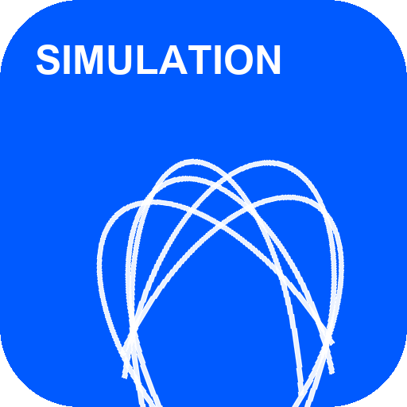
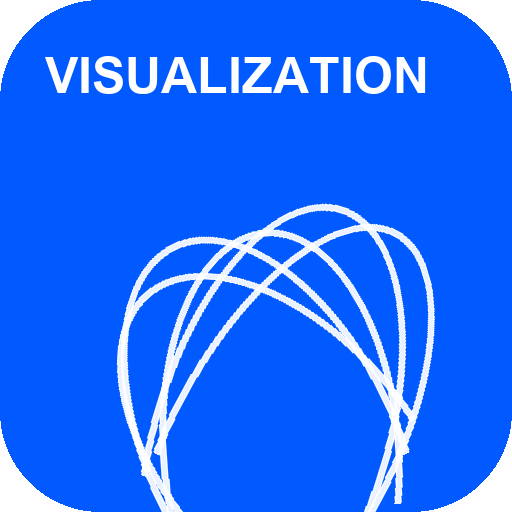
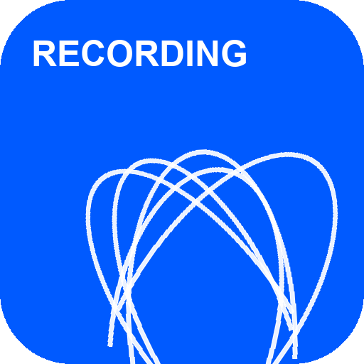
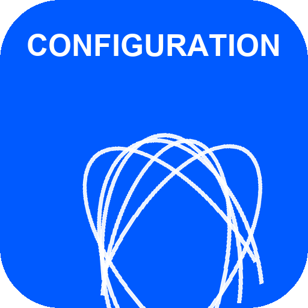
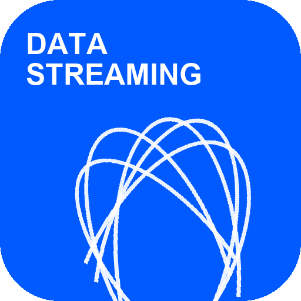
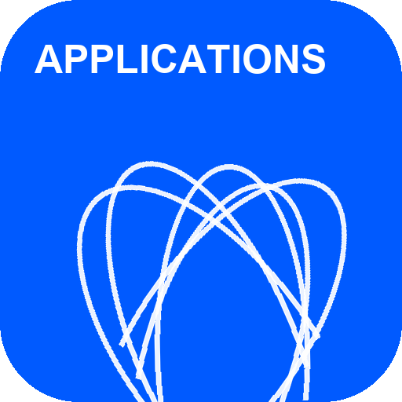
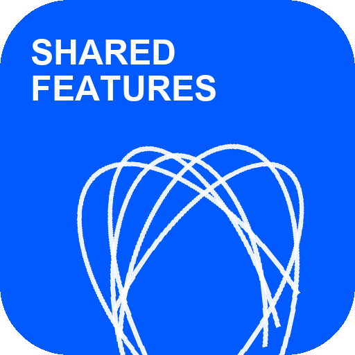
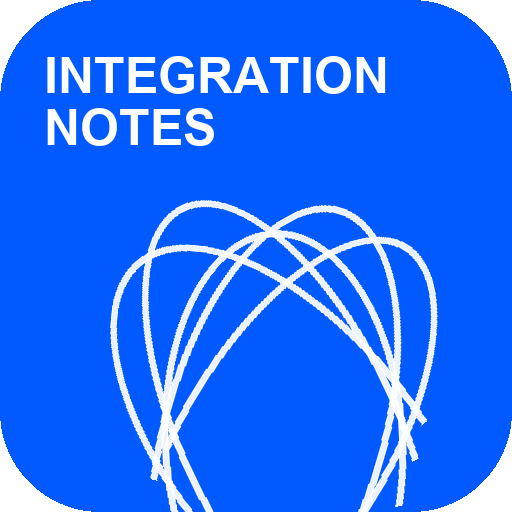
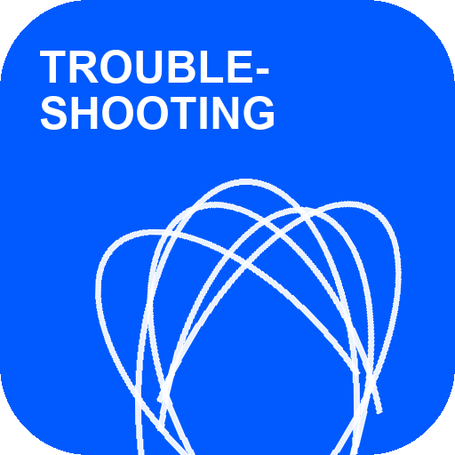
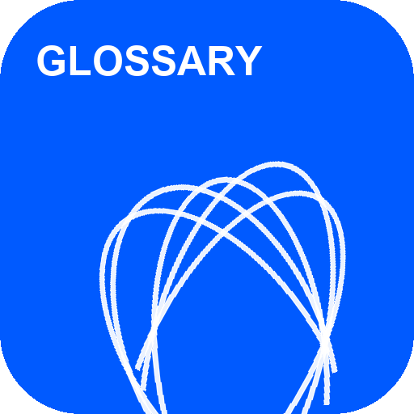

# LiDAR Developer Guide

Integrate SICK LRS4000, multiScan100, multiScan200, and picoScan100 LiDAR sensors into your application. Connect, configure through REST or CoLa, stream measurement data, and use the data in your application. Pick your device, or jump to a topic.

## Device Guides 

- 

    LiDAR Sensors

    [**LRS4000**](./LRS4000/index.md)

    Long-range 2D LiDAR sensor with motor synchronization and 3D scan recording.

    [**View Device Guide →**](./LRS4000/index.md)

- 

    LiDAR Sensors

    [**multiScan100**](./multiScan100/index.md)

    Multi-layer 3D LiDAR sensor family with segmented scan-data output.

    [**View Device Guide →**](./multiScan100/index.md)

- 

    LiDAR Sensors

    [**multiScan200**](./multiScan200/index.md)

    Compact 3D LiDAR sensor with high detection reliability in harsh environments.

    [**View Device Guide →**](./multiScan200/index.md)

- 

    LiDAR Sensors

    [**picoScan100**](./picoScan100/index.md)

    Powerful and cost-efficient 2D LiDAR sensor in a compact housing.

    [**View Device Guide →**](./picoScan100/index.md)

## Topics 

- 

    [**Simulation**](./simulation/virtual-sensor-lab.md)

    Try virtual sensors in the lab or NVIDIA Isaac Sim.

- 

    [**Visualization**](./visualization/index.md)

    Choose a tool to view live scans and point clouds.

- 

    [**Recording**](./recording/index.md)

    Capture scan data for playback, analysis, and debugging.

- 

    [**Configuration**](./configuration/index.md)

    Configure through REST or CoLa, back up settings, and enable HTTPS.

- 

    [**Data Streaming**](./data-streaming/index.md)

    Choose a transport and decode scan data or device events.

- 

    [**On-Device Applications**](./on-device-applications/field-evaluation.md)

    Evaluate fields, measure distances, and monitor contamination.

- 

    [**Shared Features**](./shared-features/device-discovery.md)

    Discover devices, update firmware, and manage timing and access.

- 

    [**Integration Notes**](./integration-notes/programming-tools-and-examples.md)

    Connect your application using SDKs, ROS, MATLAB, or a PLC.

- 

    [**Troubleshooting**](./troubleshooting.md)

    Diagnose connection, configuration, and scan-data problems.

- 

    [**Glossary**](./glossary.md)

    Look up LiDAR terms, protocols, and abbreviations.

