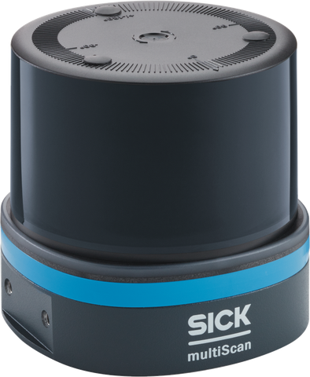

# multiScan100

multiScan100 3D LiDAR sensor.

The multiScan100 is a family of multi-layer 3D LiDAR sensors. Supported
variants include the multiScan136, multiScan165, and multiScan166. Feature
availability can depend on the device configuration and variant. Use the
Product ID (PID) to find the exact product variant on
[sick.com](https://www.sick.com/): enter the part number (P/N) and optional
serial number (S/N), for example `1134610/25250710`. A complete
[pid.sick.com](https://pid.sick.com/) URL is also accepted.

<form class="product-id-lookup" data-product-id-lookup>
  <label for="multiscan100-product-id">Product ID</label>
  

    <a class="notranslate" href="https://pid.sick.com/" translate="no">pid.sick.com/</a>
    <input id="multiscan100-product-id" name="product-id" type="text" inputmode="url" autocomplete="off" placeholder="1134610/25250710" required>
    <button type="submit">Open product</button>
  

  

</form>

Supported inputs, onboard processing functions, and outputs for the **multiScan100**.

| Input | Processing | Output |
| :---: | :---: | :---: |
| [CoLa A/B](./cola-telegram-listing.md) | [Contamination indication](../on-device-applications/contamination-indication.md) | [CoLa A/B telegrams](./cola-telegram-listing.md) |
| [Digital inputs](./electrical-connection.md) | [Device discovery](../shared-features/device-discovery.md) | [Compact over UDP](../data-streaming/compact-format.md) |
| [Ethernet](./electrical-connection.md) | [Echo filtering](../data-streaming/filter-details.md) | [Detection history](./graphical-user-interface.md) |
| [HTTPS](../configuration/https-and-certificates.md) | [Field evaluation](../on-device-applications/field-evaluation.md) | [Digital outputs](./electrical-connection.md) |
| [NTP](../shared-features/time-synchronization.md) | [Fog filtering](../data-streaming/filter-details.md) | [Field-evaluation states](../on-device-applications/field-evaluation.md) |
| [PTP](../shared-features/time-synchronization.md) | [Ground filtering](../data-streaming/filter-details.md) | [IMU data](../data-streaming/compact-format.md) |
| [REST API](./rest-api-openapi.md) | [Mounting transformation](./graphical-user-interface.md) | [MSGPACK over UDP](../data-streaming/msgpack-format.md) |
| [SOPASair](./graphical-user-interface.md) | [Moving-average filtering](../data-streaming/filter-details.md) | [Perpendicular-distance values](../on-device-applications/perpendicular-distance-measurement.md) |
| &nbsp; | [Multi-layer 3D scanning](../lidar-basics.md) | [REST JSON responses](./rest-api-openapi.md) |
| &nbsp; | [Particle filtering](../data-streaming/filter-details.md) | [ROS 2 via sick_scan_xd](../integration-notes/ros-integration.md) |
| &nbsp; | [Perpendicular distance](../on-device-applications/perpendicular-distance-measurement.md) | &nbsp; |
| &nbsp; | [Range and cuboid filtering](../data-streaming/filter-details.md) | &nbsp; |

