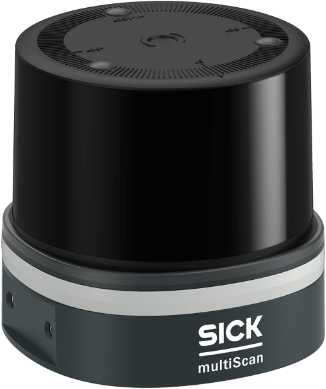

# multiScan200

multiScan200 3D LiDAR sensor.

The multiScan200 is a compact 3D LiDAR sensor family with high detection reliability in harsh environments. The first variant is the multiScan270. Use the Product ID (PID) to find the exact product variant on [sick.com](https://www.sick.com/): enter the part number (P/N) and optional serial number (S/N), for example `1134610/25250710`. A complete [pid.sick.com](https://pid.sick.com/) URL is also accepted.

<form class="product-id-lookup" data-product-id-lookup>
  <label for="multiscan200-product-id">Product ID</label>
  

    <a class="notranslate" href="https://pid.sick.com/" translate="no">pid.sick.com/</a>
    <input id="multiscan200-product-id" name="product-id" type="text" inputmode="url" autocomplete="off" placeholder="1134610/25250710" required>
    <button type="submit">Open product</button>
  

  

</form>

Supported inputs, onboard processing functions, and outputs for the **multiScan200**.

| Input | Processing | Output |
| :---: | :---: | :---: |
| [CoLa A/B](./cola-telegram-listing.md) | [Angle-range focus filtering](./cola-telegram-listing.md) | [CoLa A/B telegrams](./cola-telegram-listing.md) |
| [Digital inputs](./electrical-connection.md) | [Blooming filtering](./cola-telegram-listing.md) | [Compact over TCP](../data-streaming/compact-format.md) |
| [Gigabit Ethernet](./electrical-connection.md) | [Compact 3D scanning](../lidar-basics.md) | [Contamination status](../on-device-applications/contamination-indication.md) |
| [HTTPS](../configuration/https-and-certificates.md) | [Contamination indication](../on-device-applications/contamination-indication.md) | [Device status](./cola-telegram-listing.md) |
| [NTP](../shared-features/time-synchronization.md) | [Device discovery](../shared-features/device-discovery.md) | [Diagnostic and error data](../shared-features/error-codes.md) |
| [PTP](../shared-features/time-synchronization.md) | [Echo filtering](../data-streaming/filter-details.md) | [Digital outputs](./electrical-connection.md) |
| [REST API](./rest-api-openapi.md) | [Field evaluation](../on-device-applications/field-evaluation.md) | [Field-evaluation states](../on-device-applications/field-evaluation.md) |
| [SOPASair](../visualization/sopasair.md) | [Interval filtering](../data-streaming/filter-details.md) | [Native ROS 2 topics](../integration-notes/ros-integration.md) |
| &nbsp; | [Particle filtering](../data-streaming/filter-details.md) | [REST JSON responses](./rest-api-openapi.md) |
| &nbsp; | [Sensitivity modes](./cola-telegram-listing.md) | [Synchronized timestamps](../shared-features/time-synchronization.md) |
| &nbsp; | [Time synchronization](../shared-features/time-synchronization.md) | &nbsp; |

