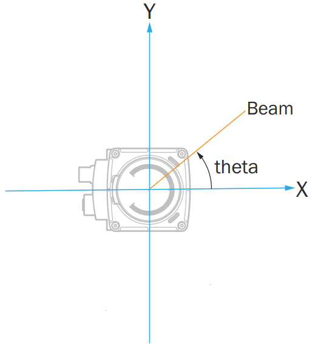
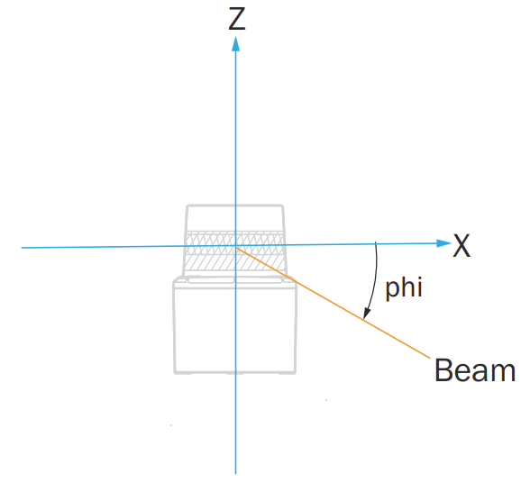

# SOPASair Walkthrough

This page describes the picoScan100 web interface and the settings in each view. Use it to commission the sensor before you automate the configuration through the API. To try the interface without a device, open it in the [Virtual Sensor Lab](../simulation/virtual-sensor-lab.md).

## Configuration

Choose the scan configuration and the core measurement behavior. Resolution, frequency, and range trade off against each other.

*Live capture from a picoScan100's web interface.*

The live scan on the left updates as you change the configuration, which is the quickest way to judge a setting.

### Basic Settings

Basic Settings controls the scan configuration used by the sensor. The settings
are shown on the right; the live scan on the left shows the effect of the
selected frequency, angular resolution, and other settings immediately. Use
this view to check coverage and measurement behavior while commissioning.

**Coordinate System**

The device coordinate system uses one point as the origin and reference for all
laser beams and distance measurements. With no translation into a world
coordinate system, this point is also the world origin.

The horizontal beam angle is **theta** (`θ`). A beam at `θ = 0°` points along
the middle of the sensor's main viewing direction, making the scan symmetric
around the X axis. The vertical elevation angle is **phi** (`φ`) and is
measured from the X/Y plane. For a single-plane picoScan, `φ = 0°` when the
sensor is ideally mounted.

*Horizontal beam angle <strong>theta</strong>.*

*Vertical beam angle <strong>phi</strong>.*

Measurement data is always output in the device coordinate system. Transform it
into a world or application frame on the receiving system after accounting for
the sensor's mounting position and orientation. See
[3D point clouds with 2D LiDARs](../integration-notes/3d-with-2d-lidars.md) for an
example coordinate transform.

**Date and system time**

The time base can be set using various methods:

- Explicitly setting the date and time
- Transferring the time from the computer used
- Via an external NTP server (Network Time Protocol) that is accessible in the network. The technology uses UDP on port 123. This setting is recommended to ensure a correct time stamp in the detection history or error entries.
- Via an external PTP (Precision Time Protocol) master that is accessible in the network. The technology uses UDP on ports 319 and 320. This setting is recommended for precise synchronization requirements (e.g. between several devices).

**Dynamic Sensing Profiles**

LiDAR applications often need different sensor characteristics at different
times. An AMR may need the shortest response time in busy areas, a large
scanning range and good angular resolution in a warehouse, and the highest
close-range angular resolution while docking. Higher angular resolution
requires a lower scanning frequency, so choose the priority for each
application.

Dynamic Sensing Profiles allow the scan's core parameters to be changed during
operation without restarting the sensor. The Scan Data Configuration function
allows fast switching between profiles:

**Basic Settings:** profile, frequency, angular resolution, and typical use.

| Profile | Frequency | Angular resolution | Typical use |
| ---: | ---: | ---: | --- |
| 1 | 15 Hz | 0.5° | Object detection with large scanning ranges |
| 2 | 15 Hz | 0.33° | TiM series retrofit |
| 3 | 20 Hz | 0.1° | Fine positioning or environment maps |
| 4 | 20 Hz | 0.25° | Low-noise measurements; recommended for LiDAR-LOC |
| 5 | 25 Hz | 0.25° | LMS100 series retrofit |
| 6 | 30 Hz | 0.1° | Fine positioning or environment maps |
| 7 | 40 Hz | 0.25° | Fast object detection at a large scanning range |
| 8 | 50 Hz | 0.25° | Very fast object detection |
| 9 | 15 Hz | 0.05° | Highest angular resolution for static measurements |
| 10 | 40 Hz | 0.125° | High angular resolution and high scan rate |
| 11 | 15 Hz | 1° | TiM series retrofit |

Available profiles depend on the device variant and license; see
[Licenses](./licenses.md).

### Filter

Clean up the scan before it leaves the sensor by suppressing extra echoes, artifacts and airborne particles.

*Example filter settings in the picoScan100 web interface. Select parameters according to the requirements of each application.*

If present, the filters are applied in the following order:

1. Fog filter
2. Echo filter
3. Particle filter
4. Moving average filter
5. Filters for data reduction and the region of interest filter

For detailed behavior and examples, see [Filter details](../data-streaming/filter-details.md).

### Inertial Measuring Unit (IMU)

Use the IMU view to inspect the sensor's current orientation and acceleration.

*Live capture from a picoScan100's web interface.*

The IMU view displays the yaw, pitch, and roll angles in degrees, together with the measured acceleration on the X, Y, and Z axes in meters per second squared. The orientation indicator provides a visual representation of the current sensor position.

Use these values as a guide when checking the sensor installation or interpreting the scan coordinate system.

### Contamination Indication

Monitor the optics cover for dirt and get a warning before measurement quality drops.

*Live capture from a picoScan100's web interface.*

The contamination status provides a live reading of Clean, Minor, Heavy, or Blocked. The segment wheel identifies where contamination is accumulating around the optics cover. Configure whether contamination triggers a warning, an error, or both, and adjust the sensitivity and outputs for the environment.

### Connection Options

Give the sensor its permanent Ethernet identity so it fits your network.

*Live capture from a picoScan100's web interface.*

Choose static addressing to enter a fixed IP address, or DHCP to have a server assign the address automatically, according to your application and network requirements. The IP address must be unique on your network. The subnet mask defines which addresses are local, for example `255.255.255.0`, and the default gateway provides access to other subnets. The MAC address and calculated speed are read-only values for reference and firewall rules.

1. Set the addressing mode to Static.
2. Enter the IP, subnet mask, and gateway for your network.
3. Press Apply.
4. Reconnect the browser at the new address.

Pressing Apply drops your current browser connection.

### Inputs and Outputs

Configure the multifunction I/O ports and map field-evaluation results and device states to physical outputs.

*Live capture from a picoScan100's web interface.*

Set each port as an input or an output and give it a name.
Bind an output to a source, such as a field-evaluation result or a device state.
Configure the logic (HIGH or LOW active), inversion, restart behavior, and status log.
The right panel shows the live status and counters for every port.

I/O is a simple way to connect a PLC when you do not want to parse the data stream.

### Configuration Related Videos

<!-- SICK video: 0_b8wyj9db; source: https://support.sick.com/sick-knowledgebase/article?id=6c3cb498-394c-f011-877a-7c1e5229e0a5 -->
*How to change the device name.*
<!-- SICK video: 0_qrr5f6m5; source: https://support.sick.com/sick-knowledgebase/article?id=34a08fc5-3a4c-f011-877a-7c1e5229e0a5 -->
*How to change scanning frequency and angular resolution.*
<!-- SICK video: 0_rz4sjkyj; source: https://support.sick.com/sick-knowledgebase/article?id=6eb433f5-a251-f011-877a-7c1e52272c21 -->
*How to configure a field for retro-reflectors only.*

## Application

### Data Output

Decide what measurement data leaves the sensor and how it is streamed to your system.

*Live capture from a picoScan100's web interface.*

For data output, select Compact, MSGPACK, LMDscandata, or Native ROS 2 according to your application. For Compact or MSGPACK, configure serialization to include only the RSSI and properties layers your application needs. Reduce bandwidth at the source with an angular-range filter that retains one sector or an interval filter that reduces the number of points.

*Compact outputs measurement data over UDP and provides separate controls for RSSI and properties serialization.*

*MSGPACK outputs measurement data over UDP to the configured destination address and port.*

*LMDscandata provides CoLa ASCII and CoLa Binary TCP ports. Restart the sensor after changing a port.*

*Native ROS 2 configures the sensor and reference coordinate frames, namespace, and DDS domain ID.*

*The IMU data output panel enables IMU streaming and configures the destination port and IP address.*

*The Encoder data output panel enables encoder-data streaming and configures the destination port and IP address.*

*The Data reduction panel reduces the transmitted data with an interval filter and an angular range filter.*

For detailed filter behavior, see [Filter details](../data-streaming/filter-details.md).

For the Compact format, a segment that lies entirely outside the selected range
is omitted. A segment that is only partly within the range remains in the output
and its outside values are filled with `0`.

*The Range filter panel limits data by rectangular X/Y coordinates or by minimum and maximum distance.*

*The scan view shows the selected region of interest and the points detected within it.*

### Data Streaming Related Videos

*picoScan100: How to use UDP multicast?*

*picoScan100: How to enable measurement data (Compact, UDP)?*

### Field Evaluation

Draw 2D detection fields and let the sensor decide, on the device, when something enters them.

*Live capture from a picoScan100's web interface.*

Fields are 2D zones that you draw around the sensor in its scan plane. The sensor reports a detection when points fall inside a field. Evaluation groups combine fields with logic and produce an actionable result. A field state can drive a physical output (see [Inputs and outputs](#inputs-and-outputs)) or appear in the detection list for your software. A group can remain active continuously or be switched by an input, for example to monitor a zone only while a machine is moving. Pan and zoom the scan view to check field coverage across the full aperture angle.

Because the evaluation runs on the sensor, this detection works without an external computer.

The following capture shows how to add a detection field in the web UI. Every field lives inside an evaluation group that pairs the field geometry with the logic and output reacting to it.

*Live capture of creating a detection field on a picoScan100.*

1. On the Field evaluation panel, click **Add group** to create an evaluation group.
2. The group opens an evaluation chain: Field → Evaluation → Output.
3. Click the Field node to define the field geometry: draw a contour, or use Teach-in to capture the current environment as the field.
4. Set the evaluation logic and wire the result to an output; the field then appears live in the 2D view.
5. Click the floppy-disk icon in the toolbar to save the configuration permanently (until you do, changes live in RAM and are lost on restart).

New evaluation groups can only be *created* in the web UI or by restoring a configuration that already contains them. Once they exist, the [REST API](../configuration/rest-interface.md) can modify their contours and activate them at runtime.

### Field Evaluation Related Articles

<!-- SICK video: 0_ap2vgkyw; source: https://support.sick.com/sick-knowledgebase/article?id=a6790049-572d-41f6-ade4-26c6c4999769 -->
*How to switch digital outputs by API.*
<!-- SICK video: 0_itn3870g; source: https://support.sick.com/sick-knowledgebase/article?id=56ef0c51-1957-f011-877b-000d3a48f570 -->
*How to use the REST API client.*
<!-- SICK video: 0_sxd1w7yl; source: https://support.sick.com/sick-knowledgebase/article?id=97f61f86-a551-f011-877a-7c1e52272c21 -->
*How to read field evaluation state through HTTP.*
<!-- SICK video: 0_c26w13xe; source: https://support.sick.com/sick-knowledgebase/article?id=e67cd7d8-a451-f011-877a-7c1e52272c21 -->
*How to activate fields through HTTP.*
- [How to draw fields and detect objects](https://support.sick.com/sick-knowledgebase/article?id=b3822c6c-a151-f011-877b-7c1e52272c21)
<!-- SICK video: 0_zk4jgiy1; source: https://support.sick.com/sick-knowledgebase/article?id=b05525fa-394c-f011-877a-000d3a206a36 -->
*How to receive contamination indication through event-driven CoLa.*
<!-- SICK video: 0_yg937a5z; source: https://support.sick.com/sick-knowledgebase/article?id=938a1b76-3899-f011-b4cc-7c1e52295e3f -->
*Distance-dependent parameter.*
<!-- SICK video: 0_itn3870g; source: https://support.sick.com/sick-knowledgebase/article?id=56ef0c51-1957-f011-877b-000d3a48f570 -->
*How to use the REST API client.*
<!-- SICK video: 0_04g93a9c; source: https://support.sick.com/sick-knowledgebase/article?id=4aad9fe3-a551-f011-877a-7c1e52272c21 -->
*How to receive field evaluation state via event-driven CoLa.*
<!-- SICK video: 0_zn7xpie7; source: https://support.sick.com/sick-knowledgebase/article?id=a1e26c44-4550-f011-877b-000d3a2a3508 -->
*How to use the object history feature.*
<!-- SICK video: 0_5fnbcj7m; source: https://support.sick.com/sick-knowledgebase/article?id=63bb7c89-4450-f011-877b-000d3a2a3508 -->
*How to use a contour as a reference.*
- [How to use a taught background for field evaluation](https://support.sick.com/sick-knowledgebase/article?id=cf43c5fc-4350-f011-b4cc-7c1e52272c21)
<!-- SICK video: 0_pp8bdva2; source: https://support.sick.com/sick-knowledgebase/article?id=246e5614-a451-f011-877a-7c1e52272c21 -->
*How to visualize detection-history bounding boxes.*

### Perpendicular Distance Measurement

Measure the perpendicular distance from the sensor's scan line to the nearest
object inside a zone, and stream that distance as a live result.

*Live capture from a picoScan100's web interface.*

*This video shows how to receive measurement data via CoLa.*

Like [field evaluation](#field-evaluation), detection runs on the device inside evaluation groups, but the result is a distance value rather than a simple field-clear/field-infringed state.

Each group holds a Perpendicular distance measurement evaluation that reports how far the closest object is, measured perpendicular to the scan.
Read the live values from the Result list for distance measurement, or over the [REST API](../configuration/rest-interface.md) / [WebSocket events](../data-streaming/websocket-events.md).
Object detection tuning keeps the reading stable. The Max. blanking size setting ignores gaps smaller than the set width, and the Detection time setting sets how long an object must be present (in scans) before it counts.

1. On the Perpendicular distance measurement panel, click **Add group**.
2. Draw the zone the measurement applies to, the same way you draw a field.
3. Set Max. blanking size and Detection time under Object detection to
   match your target and required responsiveness.
4. Read the distance in the Result list for distance measurement, or wire it
   into your software over the API.
5. Click the floppy-disk icon to save the configuration permanently (until you do,
   changes live in RAM and are lost on restart).

Because the measurement runs on the sensor, you get a ready-to-use distance value without processing the raw scan on a host.

*The Result list shows the minimum and maximum distance and the coordinates of the measuring points for each evaluation.*

## Diagnostics

The health dashboard shows device status, operating data, messages, and the diagnostic file.

*Live capture from a picoScan100's web interface.*

The dashboard shows device, connection, measurement, and data-output status at a glance. It also displays the power-on counter, operating hours, temperature, and most recent parameterization. Its event log records messages with their severity, ID, time, and description, and it can be filtered. You can create and download a diagnostic file for SICK service.

Creating a new diagnostic file overwrites the previous one.

### Status LEDs

The two status LEDs on the housing show the device state at a glance.

**Status LEDs:** LED1, LED2, and meaning.

| LED1 | LED2 | Meaning |
| --- | --- | --- |
|  Red |  Red | Booting, parameterizing or firmware update |
| – | – | Off |
|  Red, flashing fast |  Red, flashing fast | Fatal error |
|  Red, flashing slowly |  Red, flashing slowly | Recoverable error |
|  Green |  Green | Ready, no object detected in configured fields |
| – |  Green | Ready, no fields configured |
|  Green |  Yellow, flashing | Warning |
|  Yellow |  Green, flashing | Restart after time or digital input |
|  Green |  Yellow, flashing | Contamination warning |
|  Red, flashing |  Yellow, flashing | Contamination error |
|  Green, yellow, red |  Green, yellow, red | Identify device |
|  Red |  Red and yellow, flashing | Teach-in environment |
|  Yellow |  Green | Object detected |

 illuminated ·  flashing · – off

You can switch the LEDs off in the web interface or with `sWN LEDEnable`, and
read their state with `sRN LEDState`.

### Cybersecurity

Harden the sensor by managing certificates and switching network services on or off.

*Live capture from a picoScan100's web interface.*

Use this page to create an HTTPS certificate for encrypted access and enable only the required services and protocols, such as CoLa, device search, the web server, HTTPS, or SSH. Each row shows its purpose and physical and logical port to support firewall planning. Disable legacy protocols and developer access in production.

### Detection History

Record and review how often each field evaluation triggered.

*Live capture from a picoScan100's web interface.*

Start or stop recording detections across all evaluation groups.
Choose which groups and fields to include.
The statistics section shows the detection count per evaluation as live bars.
A link jumps to the field evaluation to adjust fields.

### Diagnostics Related Articles

<!-- SICK video: 0_nifqhzs0; source: https://support.sick.com/sick-knowledgebase/article?id=12a740bc-9568-f011-bec1-000d3abc6bf4 -->
*How to read internal device temperature.*
