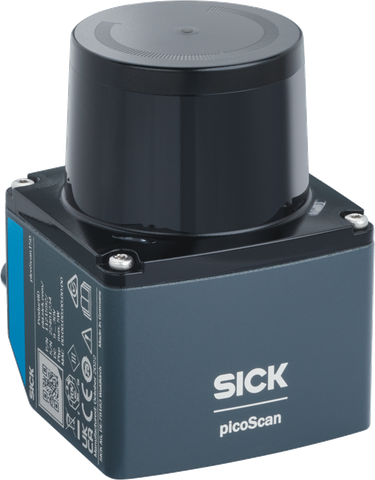

# picoScan100

picoScan100 2D LiDAR sensor.

The picoScan100 is a compact 2D LiDAR sensor with one scan plane and a 276° scan range. It comes in two variants: the picoScan120 and the picoScan150. Use the Product ID (PID) to find the exact product variant on [sick.com](https://www.sick.com/): enter the part number (P/N) and optional serial number (S/N), for example `1134610/25250710`. A complete [pid.sick.com](https://pid.sick.com/) URL is also accepted.

<form class="product-id-lookup" data-product-id-lookup>
  <label for="picoscan100-product-id">Product ID</label>
  

    <a class="notranslate" href="https://pid.sick.com/" translate="no">pid.sick.com/</a>
    <input id="picoscan100-product-id" name="product-id" type="text" inputmode="url" autocomplete="off" placeholder="1134610/25250710" required>
    <button type="submit">Open product</button>
  

  

</form>

Supported inputs, onboard processing functions, and outputs for the **picoScan100**.

| Input | Processing | Output |
| :---: | :---: | :---: |
| [CoLa A/B](./cola-telegram-listing.md) | [2D scan profiles](./graphical-user-interface.md) | [CoLa A/B telegrams](./cola-telegram-listing.md) |
| [Digital inputs](./electrical-connection.md) | [Contamination indication](../on-device-applications/contamination-indication.md) | [Compact over UDP](../data-streaming/compact-format.md) |
| [Ethernet](./electrical-connection.md) | [Device discovery](../shared-features/device-discovery.md) | [Contamination status](../on-device-applications/contamination-indication.md) |
| [HTTPS](../configuration/https-and-certificates.md) | [Echo filtering](../data-streaming/filter-details.md) | [Digital outputs](./electrical-connection.md) |
| [IMU](./graphical-user-interface.md) | [Field evaluation](../on-device-applications/field-evaluation.md) | [Field-evaluation states](../on-device-applications/field-evaluation.md) |
| [NTP](../shared-features/time-synchronization.md) | [Fog filtering](../data-streaming/filter-details.md) | [IMU data](../data-streaming/compact-format.md) |
| [PoE](./electrical-connection.md) | [Interval filtering](../data-streaming/filter-details.md) | [LMDscandata over TCP](../data-streaming/lmdscandata-format.md) |
| [PTP](../shared-features/time-synchronization.md) | [Moving-average filtering](../data-streaming/filter-details.md) | [MSGPACK over UDP](../data-streaming/msgpack-format.md) |
| [PWR and I/O connector](./electrical-connection.md) | [Particle filtering](../data-streaming/filter-details.md) | [Native ROS 2 topics](../integration-notes/ros-integration.md) |
| [REST API](./rest-api-openapi.md) | [Perpendicular distance](../on-device-applications/perpendicular-distance-measurement.md) | [Perpendicular-distance values](../on-device-applications/perpendicular-distance-measurement.md) |
| [SOPASair](./graphical-user-interface.md) | [Radial-distance filtering](../data-streaming/filter-details.md) | [REST JSON responses](./rest-api-openapi.md) |
| [WebSocket](../data-streaming/websocket-events.md) | [Region-of-interest filtering](../data-streaming/filter-details.md) | [WebSocket JSON events](../data-streaming/websocket-events.md) |
| &nbsp; | [Sensitivity modes](./graphical-user-interface.md) | &nbsp; |

